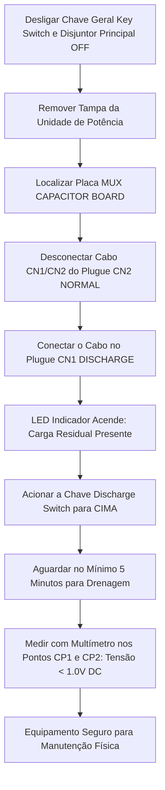

# INSTRUÇÃO DE TRABALHO (IT-RXM-SHIM-001)

|  | **EMED ELETROMEDICINA LTDA.** **Diagnóstico por Imagem** CNPJ: 03.611.974/0001-08 | **CÓDIGO:** `IT-RXM-SHIM-001` **VERSÃO:** `2.4 Homologada` **REVISÃO:** `Rev. 02 (26/10/2026)` **NORMA:** `ANVISA RDC 611` |
|:---:|:---|:---|

---

## Manutenção Preventiva, Diagnóstico de Falhas & Descarga Segura de Capacitores
### Raio-X Móvel Digital Shimadzu MobileDaRt Evolution (Versões MX8 & MX9)
*Baseado no manual oficial de serviço Shimadzu M503-E411F / M503-E404H*

---

### 1. OBJETIVO & APLICAÇÃO
Padronizar os procedimentos de segurança elétrica, desenergização e descarga dos bancos de capacitores de alta tensão, diagnóstico dos códigos de erro da linha **F** (geração) e **d** (tração motorizada), e verificação das baterias no sistema móvel de radiografia digital **Shimadzu MobileDaRt Evolution MX8**.

---

### 2. PROTOCOLO DE VIDA OU MORTE: DESCARGA DOS CAPACITORES DO GERADOR DE 32kW

> [!DANGER]
> **RISCO DE CHOQUE ELÉTRICO FATAL POR TENSÃO RESIDUAL (> 100V DC):**
> Mesmo com a chave geral (*Key Switch*) desligada e o disjuntor principal (*Main Breaker*) na posição OFF, **os capacitores de armazenamento de energia do gerador de 32kW permanecem carregados com alta tensão**. É expressamente proibido tocar em qualquer componente da unidade de potência sem realizar o procedimento de descarga abaixo!

#### 2.1 Passo a Passo da Descarga
1. Desligue a chave de ignição (*Key Switch*) e desarme o disjuntor principal (*Main Breaker*).
2. Remova as tampas de proteção da unidade de potência inferior.
3. Localize a placa **MUX CAPACITOR BOARD**.
4. Desconecte o cabo interno identificado como `CN1/CN2` que se encontra inserido no conector **`CN2 (NORMAL)`**.
5. Conecte esse mesmo cabo no conector **`CN1 (DISCHARGE)`**.
6. **Verificação Visual:** O LED vermelho da placa MUX CAPACITOR acenderá imediatamente caso ainda exista carga elétrica armazenada nos capacitores.
7. Mova a chave seletora **`Discharge Switch`** para a **posição SUPERIOR (ON/UP)**.
8. Os resistores internos de potência ($R_3$ e $R_4$) iniciarão a queima/drenagem térmica da energia.
9. **Tempo de Espera:** Aguarde pelo menos **5 minutos** completos.
10. **Aferição com Multímetro:** Com um multímetro digital na escala DC, meça a tensão entre os pinos de teste **`CP1`** e **`CP2`** da placa MUX CAPACITOR.
    * **Critério de Segurança:** A tensão residual deve ser obrigatoriamente **inferior a $1,0\text{V DC}$**.
    * Apenas após essa confirmação o circuito de alta tensão estará liberado para intervenção física.

---

### 3. TABELA MESTRA DE DIAGNÓSTICO DE CÓDIGOS DE ERRO (TROUBLESHOOTING)

Os erros do MobileDaRt MX8 são divididos em erros de Raios-X (**F**), falhas de movimentação/tração (**d**) e avisos térmicos (**H**):

| Código | Descrição da Falha | Causa Provável | Ação Corretiva do Técnico em Campo |
| :---: | :--- | :--- | :--- |
| **`F15`** | Queda de tensão de tubo durante disparo ($> 10\%$ abaixo do nominal) | Baterias fracas ou desbalanceadas; falha no ajuste FVR | 1. Medir tensão estática e sob carga das baterias. 2. Recarregar o equipamento na tomada por 2 horas. 3. Verificar sinais `(TKV)`, `(KV+)`, `(KV-)` na placa XCONT. |
| **`F16`** | Chaveamento do feedback de kV incorreto | Erro de comutação de alta tensão | Inspecionar relés da placa MUX POWER e fiação de retorno do transformador HV. |
| **`F24`** | Corrente de filamento (mA) $> 100\text{ mA}$ acima do programado | Falha no controle de disparo (HW Overcurrent) | 1. Conferir ajuste FVR na placa XCONT. 2. Atualizar firmware para Rev. 1.50 ou superior. 3. Verificar sinais `(TMA)` e `(IFV)`. |
| **`F47`** | Tensão do banco de capacitores abaixo do nível de prontidão por $> 30\text{ s}$ | Fuga de corrente ou relé de pré-carga defeituoso | Medir tensão entre `VC+` e `VC0` na placa MUX CAPACITOR. Verificar fusíveis de alimentação. |
| **`F51` / `F53`** | Sobretensão de carga das baterias ($> 155\text{V DC}$) no lado positivo (`F51`) ou negativo (`F53`) | Carregador com defeito ou célula em curto | Inspecionar placa MUX CHARGE 32KX e medir tensão individual de cada bateria de $12\text{V}$. |
| **`d24`** | Erro de rotação do Motor Direito de tração | Cabo de encoder ou motor desconectado | 1. Verificar conexão `CN7` na placa MU DRIVER. 2. Checar aterramento (GND) da blindagem do cabo do encoder no chassi. |
| **`d25`** | Erro de rotação do Motor Esquerdo de tração | Motor esquerdo preso ou desconexão | 1. Verificar conexão do motor esquerdo. 2. Testar rotação livre da roda levantando o chassi. |
| **`d29`** | Falha de sinal no Encoder do Motor Esquerdo | Mau contato no sensor óptico/magnético | Inspecionar conector `CN6` na placa MU DRIVER e o parafuso de fixação do terra do encoder. |
| **`d61`** | Falha de comunicação entre placas de controle | Cabo de barramento solto | Checar conexão entre conector `CN21` (MU DRIVER) e `CNUM` (XCONT). |
| **`H1` / `H2`** | Aviso de sobreaquecimento térmico do Tubo | Disparos sucessivos em UTI sem intervalo de resfriamento | Aguardar resfriamento. Se o alarme persistir com o tubo frio, checar a bateria da placa XCONT e resetar a SRAM. |

---

### 4. AVALIAÇÃO E TESTE DO BANCO DE BATERIAS DE TRAÇÃO E DISPARO

O MobileDaRt MX8 utiliza um banco modular de baterias seladas de chumbo-ácido (VRLA).

#### 4.1 Teste Rápido de Degradação de Bateria
* Quando o equipamento apresentar os erros `F12`, `F15` ou `F16` em exposições de alta técnica ($> 100\text{ kV}$ e $> 200\text{ mA}$):
  1. Conecte o cabo de força à rede elétrica ($110\text{V} / 220\text{V}$) e carregue por 30 minutos;
  2. Repita o disparo com o equipamento conectado à tomada;
  3. **Diagnóstico:** Se o erro desaparecer durante a carga, confirma-se inequivocamente que as baterias atingiram o fim de vida útil e perderam a capacidade de fornecer corrente de pico.

#### 4.2 Aferição Individual de Células
* Desconecte os jumpers entre os blocos de bateria;
* Meça a tensão de repouso de cada bloco de $12\text{V}$:
  * Bateria Saudável: $\ge 12,6\text{V DC}$;
  * Bateria em Fim de Vida / Célula Morta: $\le 11,8\text{V DC}$;
  * A diferença máxima entre a bateria mais forte e a mais fraca do banco não pode exceder **$0,3\text{V}$**.

---

### 5. ALINHAMENTO DO CAMPO LUMINOSO LED DO COLIMADOR COM O FEIXE DE RAIO-X

Após substituição da lâmpada LED do colimador ou manutenção no conjunto de lâminas:
1. Posicione o colimador a uma distância foco-filme (DFI) de **$100\text{ cm}$** em relação ao chassi/detector.
2. Acione o feixe luminoso do colimador e marque com fitas radiopacas ou moedas os 4 cantos do campo de luz projetado.
3. Realize um disparo radiográfico em técnica baixa ($50\text{ kV}$, $2\text{ mAs}$).
4. Meça a diferença entre as bordas da sombra de luz e as bordas da área exposta no receptor de imagem:
   * **Tolerância Conforme Norma:** A discrepância total entre o campo de luz e o campo de Raio-X não pode exceder **$2\%$ da DFI ($2\text{ cm}$ a $100\text{ cm}$)**.
5. Ajuste a posição do suporte do LED ou o anel de rotação do colimador até atingir a sobreposição exata.
