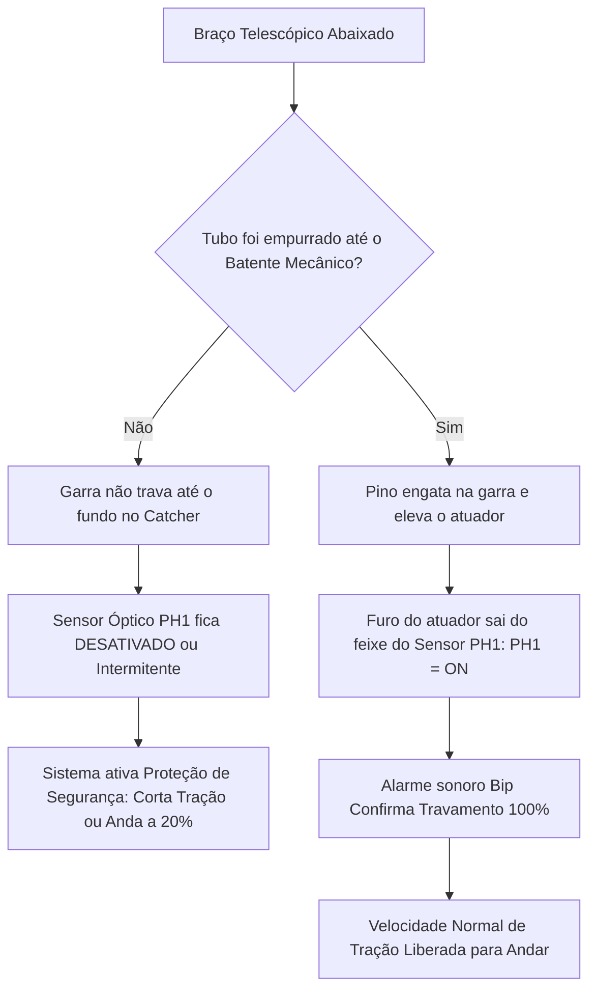

# INSTRUÇÃO DE TRABALHO (IT-RXM-SHIM-002)
## Calibração da Manopla com Balança / Dinamômetro (FSR) & Ajuste do Sensor do Braço no Catcher
### Raio-X Móvel Digital Shimadzu MobileDaRt Evolution (Versão MX8 & MX9)
*Baseado nos Manuais Oficiais Shimadzu M503-E404H (Seção 7.5 e 7.1) e M503-E411F (Seções 4.3 e 4.4)*

---

### 1. OBJETIVO & SINTOMAS DE CAMPO
Esta Instrução de Trabalho padroniza a calibração do sistema de assistência motorizada de tração (andar para frente e para trás) e o ajuste do intertravamento do braço telescópico na base.

#### Sintomas Comuns no Hospital que Exigem esta Calibração:
1. **O equipamento não anda ou fica extremamente pesado para empurrar/puxar;**
2. **O equipamento anda sozinho em repouso (*drifting*) sem o técnico empurrar a manopla;**
3. **Queda repentina de velocidade ao passar por desníveis/solavancos no piso do hospital;**
4. **Erros no painel:** `A7` ou `A8` (entrada indevida da manopla ao ligar), `d24`, `d25` ou `d29` (erros de rotação dos motores/sensores de esforço FSR).

---

### 2. FERRAMENTAS & INSTRUMENTOS OBRIGATÓRIOS
* **Balança de Mola / Dinamômetro Digital de Tração (capacidade mínima de 0 a 5 kgf)**;
* **Cordinha fina ou laço de fita resistente** (para engate na manopla);
* **Multímetro Digital calibrado com pontas de teste finas**;
* **Chaves Allen e Chave Phillips nº 2** (para acesso às tampas laterais se necessário).

---

### 3. PROCEDIMENTO 1: CALIBRAÇÃO DA MANOPLA COM A BALANÇA DE MOLA (FSR ADJUSTMENT)

Os sensores FSR (*Force Sensing Resistors*) instalados dentro da manopla de direção medem a força da mão do operador para frente e para trás em ambos os lados (esquerdo e direito), modulando a velocidade dos motores DC através da placa **MU DRIVER-07**.

```
                           [ PAINEL DE COMANDO ]
                                     |
               +---------------------+---------------------+
               |                                           |
      (Manopla Esquerda - L)                      (Manopla Direita - R)
      Frente: Posições 1, 2, 3                    Frente: Posições 7, 8, 9
      Trás:   Posições 4, 5, 6                    Trás:   Posições 10, 11, 12
```

#### 3.1 Como Entrar no Modo de Ajuste sem Abrir Tampas (Método Rápido de Teclado)
1. Desconecte o plugue de força da tomada da parede e certifique-se de que o equipamento esteja **desligado**.
2. Ligue a chave geral (*Key Switch*).
3. No painel de comando de Raios-X, **pressione e segure a tecla [Setting Change] por mais de 3 segundos**.
4. Aguarde até que o visor mude para a tela de ID.
5. Em menos de 3 segundos, pressione a tecla numérica **`<7>`** e, em seguida, a tecla da **Lâmpada do Colimador**.
6. O visor de mAs exibirá a versão de software (ex: `1.00`) e entrará no menu de serviço.
7. Pressione a tecla **[INFO]** para selecionar o Modo de Ajuste (*Adjustment Mode*) e confirme na tecla **[Registration]**.

*(Nota: Caso prefira o método por hardware, basta abrir a tampa lateral direita e ligar a chave DIP `SW3-8` da placa **XCONT-2018** em ON).*

#### 3.2 Calibração dos 12 Pontos de Tração com a Balança
1. No painel, pressione a tecla **`<6>`** para entrar no modo **Adjustment of the Handle Mode**:
   * O LED da tecla `<1>` começará a piscar;
   * O LED da tecla `<6>` começará a piscar;
   * O visor de kV exibirá o **número da posição de ajuste atual (1 a 12)**.
2. Amarre um pedaço de cordão ou fita na extremidade da manopla e enganche a ponta da **balança de mola / dinamômetro**.
3. Puxe gradualmente na direção e peso indicados na tabela oficial Shimadzu abaixo:

| Posição no Display | Direção do Esforço | Peso / Força Aplicada na Balança | Ação de Confirmação |
| :---: | :---: | :---: | :--- |
| **`1`** | **Para FRENTE (Lado Esquerdo)** | **$1,0\text{ kg}$** *(Dica: puxe a 3 kg para trás e volte a 1 kg para frente)* | Pressionar **[Registration]** |
| **`2`** | **Para FRENTE (Lado Esquerdo)** | **$1,5\text{ kg}$** | Pressionar **[Registration]** |
| **`3`** | **Para FRENTE (Lado Esquerdo)** | **$3,0\text{ kg}$** | Pressionar **[Registration]** |
| **`4`** | **Para TRÁS (Lado Esquerdo)** | **$1,0\text{ kg}$** | Pressionar **[Registration]** |
| **`5`** | **Para TRÁS (Lado Esquerdo)** | **$1,5\text{ kg}$** | Pressionar **[Registration]** |
| **`6`** | **Para TRÁS (Lado Esquerdo)** | **$3,0\text{ kg}$** | Pressionar **[Registration]** |
| **`7`** | **Para FRENTE (Lado Direito)** | **$1,0\text{ kg}$** *(Dica: puxe a 3 kg para trás e volte a 1 kg para frente)* | Pressionar **[Registration]** |
| **`8`** | **Para FRENTE (Lado Direito)** | **$1,5\text{ kg}$** | Pressionar **[Registration]** |
| **`9`** | **Para FRENTE (Lado Direito)** | **$3,0\text{ kg}$** | Pressionar **[Registration]** |
| **`10`** | **Para TRÁS (Lado Direito)** | **$1,0\text{ kg}$** | Pressionar **[Registration]** |
| **`11`** | **Para TRÁS (Lado Direito)** | **$1,5\text{ kg}$** | Pressionar **[Registration]** |
| **`12`** | **Para TRÁS (Lado Direito)** | **$3,0\text{ kg}$** | Pressionar **[Registration]** |

> [!IMPORTANT]
> **GRAVAÇÃO OBRIGATÓRIA:**
> Ao aplicar a força com a balança, mantenha a mão firme sem tremer e pressione a tecla **[Registration]**. O painel apitará e avançará automaticamente para o próximo número. Se desligar o equipamento sem pressionar [Registration], os dados serão descartados.

#### 3.3 Verificação e Critérios de Aprovação dos Valores AD
1. Pressione a tecla **[Filter]** no painel: o visor exibirá a letra `"r"` seguida dos valores numéricos brutos do conversor AD;
2. Navegue pelos pontos 1 a 12 utilizando as teclas `[kV +]` e `[kV -]`;
3. **Tabela de Referência Padrão de Fábrica Shimadzu:**

| Posição de Teste | Esquerda (L) - AD | Direita (R) - AD | Força de Referência |
| :---: | :---: | :---: | :---: |
| **Posições 3 e 9 (Frente)** | **$799 \pm 30$** | **$807 \pm 30$** | $3,0\text{ kg}$ |
| **Posições 2 e 8 (Frente)** | **$744 \pm 30$** | **$756 \pm 30$** | $1,5\text{ kg}$ |
| **Posições 1 e 7 (Frente)** | **$663 \pm 30$** | **$687 \pm 30$** | $1,0\text{ kg}$ |
| *Posição Neutra (Repouso)* | *~ 500 ($2,5\text{V}$)* | *~ 500 ($2,5\text{V}$)* | *0 kg (Mão solta)* |
| **Posições 4 e 10 (Trás)** | **$362 \pm 30$** | **$352 \pm 30$** | $1,0\text{ kg}$ |
| **Posições 5 e 11 (Trás)** | **$276 \pm 30$** | **$282 \pm 30$** | $1,5\text{ kg}$ |
| **Posições 6 e 12 (Trás)** | **$219 \pm 30$** | **$220 \pm 30$** | $3,0\text{ kg}$ |

* **Regras de Aceitação Obrigatórias:**
  * A diferença entre o ponto Neutro e $1,0\text{ kg}$ deve ser $\ge \mathbf{50\text{ pontos}}$;
  * A diferença entre $1,0\text{ kg}$ e $1,5\text{ kg}$ deve ser $\ge \mathbf{20\text{ pontos}}$;
  * Em nenhuma hipótese o valor de $1,5\text{ kg}$ pode ser maior que o de $3,0\text{ kg}$ (não pode haver inversão). Se houver, a manopla ou o cabo FSR está danificado.

---

### 4. PROCEDIMENTO 2: O SEGREDO DO BRAÇO NO CATCHER (POR QUE O EQUIPAMENTO NÃO ANDA)

Um dos maiores motivos de chamados com o relato *"o equipamento parou de andar"* ou *"a tração ficou lenta demais"* é o **sensor óptico PH1 do Catcher ASSY** (conjunto de trava do braço na base).



#### 4.1 Modo Correto de Travar o Braço (Instrução Operacional Obrigatória)
1. Antes de baixar o braço para o suporte da base (*Catcher*), **empurre o tubo de Raio-X contra a coluna até encostar firmemente no batente mecânico (*Mechanical Stopper*)**.
2. Apenas depois de encostado no batente, abaixe o braço telescópico verticalmente em direção ao Catcher.
3. Se feito corretamente, você ouvirá o clique mecânico da garra e o **alarme sonoro curto (*bip*)** do painel confirmando que o sensor PH1 foi ativado.

#### 4.2 Ajuste Mecânico do Sensor PH1 (Caso o Braço não Trave ou Fique Falhando)
1. Desligue o equipamento e remova a tampa superior (*Top Plate*) e a cobertura do Catcher ASSY.
2. Observe o atuador mecânico móvel e o sensor óptico tipo garfo **PH1**:
   * Quando o braço está solto, o orifício do atuador fica alinhado com o sensor PH1 (PH1 = OFF);
   * Quando o pino do braço engata na garra (*claw*), o atuador sobe e bloqueia o feixe de luz do sensor PH1 (PH1 = ON).
3. **Ajuste da Posição do Sensor:** Afrouxe o parafuso de fixação do sensor PH1 através do orifício de acesso e ajuste a altura para garantir que, com o braço engatado, o sensor comute com folga segura de pelo menos **$1,5\text{ mm}$**.
4. **Verificação do Batente de Borracha:**
   * Inspecione o anel espaçador de borracha localizado no pino de $\varnothing 12\text{ mm}$ ao lado do pino da junta do braço.
   * Se a borracha estiver desgastada ou partida, o braço afunda além do ponto ideal.
   * **Solução Técnica de Campo / Provisória:** Substitua o espaçador de borracha ou insira provisoriamente uma arruela calibrada de **$1,0\text{ mm}$** de espessura na base do pino.

---

### 5. FINALIZAÇÃO E TESTE DINÂMICO DE LIBERAÇÃO
1. Reinicie o equipamento na chave geral para sair do modo de ajuste (*Adjustment Mode*);
2. Trave o braço no Catcher e confirme o bip sonoro;
3. Segure a manopla de tração com as duas mãos:
   * Empurre suavemente para frente: o freio eletromagnético deve desarmar com clique suave e o equipamento deve acelerar suave e progressivamente sem trancos;
   * Puxe suavemente para trás: o sistema deve recuar de forma estável;
   * Solte as mãos: o equipamento deve frear suavemente até parar por completo, **sem creeping (sem rastejar sozinho)**.
4. Ordem de Serviço liberada com 100% de sucesso!
