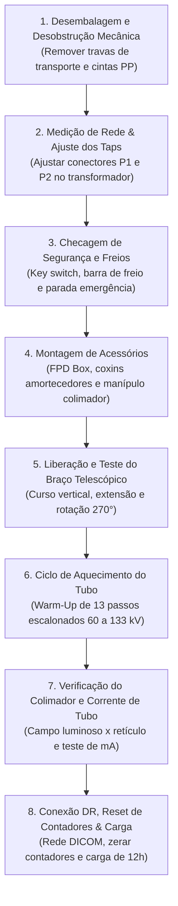

# INSTRUÇÃO DE TRABALHO TÉCNICA

|  | **EMED ELETROMEDICINA LTDA.** **Diagnóstico por Imagem** CNPJ: 03.611.974/0001-08 | **CÓDIGO:** `IT-RXM-SHIM-003` **VERSÃO:** `2.4 Homologada` **REVISÃO:** `Rev. 02 (26/10/2026)` **NORMA:** `ANVISA RDC 611` |
|:---:|:---|:---|

---

## IT-RXM-SHIM-003: Roteiro Completo de Instalação, Montagem Mecânica & Comissionamento em Campo
**Equipamento:** Shimadzu MobileDaRt Evolution / MX8 Version (Raio-X Móvel Motorizado)  
**Potência do Gerador:** 32 kW (Alta Potência com Banco de Capacitores) / 12.5 kW  
**Documento Base de Fábrica:** Manual de Instalação Shimadzu M503-E410 (560 páginas)  
**Público-Alvo:** Diagnóstico por Imagem & Especialistas de Campo eMED  
**Revisão:** 1.0 - Procedimento Oficial de Entrega Técnica e Comissionamento  

---

### 1. OBJETIVO E ESCOPO
Padronizar a rotina completa de instalação física, desobstrução das travas de transporte, parametrização da tensão da rede elétrica, montagem mecânica de acessórios, aquecimento escalonado do tubo (*Warm-up*), calibração funcional e entrega técnica do equipamento de raio-X móvel digital Shimadzu MobileDaRt Evolution / MX8.

---

### 2. FERRAMENTAL E EQUIPAMENTOS NECESSÁRIOS EM CAMPO

Antes de se deslocar para o cliente, certifique-se de portar o seguinte kit de instalação:

| Item | Ferramenta / Equipamento | Finalidade no Procedimento |
| :---: | :--- | :--- |
| **1** | Jogo de chaves Allen métricas (2,5 mm a 10 mm) | Desmontagem de travas de transporte e tampas |
| **2** | Chaves Phillips (PH1, PH2, PH3) e Chave de Fenda | Fixação de tampas, FPD box e conectores |
| **3** | Multímetro Digital True-RMS (com pontas e garras jacaré) | Medição da tensão da tomada e verificação de aterramento |
| **4** | Alicate de corte diagonal e alicate universal | Remoção de cintas PP de transporte e abraçadeiras |
| **5** | Abraçadeiras plásticas de nylon (cable ties) | Amarração de chicotes do detector e acessórios |
| **6** | Álcool isopropílico 99,8% e panos de microfibra limpos | Limpeza óptica do colimador e superfícies plásticas |
| **7** | Graxa técnica branca para engrenagens | Lubrificação suave de guias se necessário |
| **8** | Trena métrica de precisão (3m ou 5m) | Verificação de centralização do campo luminoso |
| **9** | Teclado e Mouse USB convencionais | Configuração do PC industrial DR e rede hospitalar |
| **10** | Pen Drive de Serviço e Cabo de Rede RJ45 Cat6 | Testes de comunicação DICOM / PACS e backup |

---

### 3. PRECAUÇÕES CRÍTICAS DE SEGURANÇA

> [!CAUTION]
> **RISCO DE CHOQUE ELÉTRICO E ALTA TENSÃO RESIDUAL (BANCO DE CAPACITORES):**  
> No modelo de 32 kW, existem capacitores de altíssima densidade energética acoplados às baterias.  
> Mesmo com a chave geral (*Key switch*) e o disjuntor principal (*Main circuit breaker*) desligados, **os capacitores mantêm carga perigosa**.  
> Caso necessite abrir compartimentos internos de potência, efetue a descarga conectando o cabo `CN1/CN2` no conector `CN1 DISCHARGE` da placa `MUX CAPACITOR` até o LED apagar.

> [!WARNING]
> **PERIGO DE QUEIMA POR TENSÃO INCORRETA (PADRÃO DE FÁBRICA 100V AC):**  
> O equipamento sai do Japão configurado de fábrica para **100V AC**.  
> **NUNCA ligue o cabo de força na tomada do hospital antes de verificar e alterar os seletores P1 e P2 para 220V/230V.** A tentativa de carregar as baterias sem alterar o tap causará a queima imediata da placa de carga e risco de incêndio!

---

### 4. ROTEIRO PASSO A PASSO DE INSTALAÇÃO

---

#### ETAPA 1: Desembalagem e Remoção das Travas de Transporte (*Fixing Brackets*)
1. Remova o plástico bolha, papelão e a capa externa de proteção do equipamento.
2. **Remoção do parafuso de trava de rotação do colimador:**
   - No cabeçote, desaperte e remova o parafuso temporário vermelho/amarelo que impede a rotação do colimador.
3. **Remoção dos suportes metálicos de fixação do braço:**
   - Na coluna e no braço, desparafuse os suportes de retenção de transporte (*Arm fixing brackets*) e os suportes de proteção de placa (*Board protection brackets*).
4. **Corte das cintas de retenção do tubo:**
   - Corte e descarte as duas cintas plásticas azuis/pretas (*PP-bands*) que amarram o monobloco do tubo de raios-X à estrutura.
5. **Acomodação dos suportes de transporte:**
   > [!IMPORTANT]
   > Guarde todos os suportes metálicos de fixação de transporte e entregue ao responsável da Diagnóstico por Imagem do hospital ou acomode no compartimento de manutenção. Eles serão **obrigatórios** caso o equipamento precise ser embarcado em caminhão para transferência no futuro.
6. **Inspeção das rodas de tração:**
   - Se o equipamento ficou armazenado em caixote por muito tempo, a borracha das rodas traseiras pode apresentar uma leve deformação plana (achatamento). Isso é normal e desaparece sozinho após os primeiros minutos de condução do equipamento.

---

#### ETAPA 2: Ajuste Obrigatório da Tensão da Tomada Hospitalar (Taps P1 / P2)
1. Certifique-se de que o **Disjuntor Principal** (*Main Circuit Breaker*, na base frontal do chassi) e a chave geral estão em **OFF**.
2. Abra a tampa lateral direita do chassi:
   - Solte os parafusos de fixação da tampa e desencaixe a cobertura lateral.
3. Com o multímetro digital em escala AC, meça a tomada hospitalar onde o equipamento será carregado:
   - Anote a tensão medida (geralmente entre $218\text{V}$ e $225\text{V}$ na rede 220V brasileira).
4. Localize os conectores **P1** e **P2** do transformador de alimentação e posicione conforme a tabela oficial:

| Tensão Medida na Tomada | Conector P1 | Conector P2 | Configuração no Brasil |
| :---: | :---: | :---: | :---: |
| **$220\text{V} \pm 10\%$** | **`A0`** | **`A220`** | **Padrão mais comum no Brasil (220V monofásico/bifásico)** |
| **$230\text{V} \pm 10\%$** | **`A+10`** | **`A220`** | Rede alta (locais com 230V estável) |
| **$240\text{V} \pm 10\%$** | **`A0`** | **`A240`** | Rede industrial 240V |
| **$120\text{V} \pm 10\%$** | **`A0`** | **`A120`** | Rede 127V / 120V |
| **$110\text{V} \pm 10\%$** | **`A+10`** | **`A100`** | Rede 110V |
| **$100\text{V} \pm 10\%$** | **`A0`** | **`A100`** | *Configuração de fábrica japonesa (NÃO USAR NO BRASIL)* |

5. Cole a etiqueta de advertência de tensão correspondente (fornecida no kit de peças de instalação) junto à saída do plugue de alimentação da máquina.
6. Feche a tampa lateral direita e aperte os parafusos de fixação.
7. Ligue o disjuntor principal (*Main Circuit Breaker* $\rightarrow$ **ON**).

---

#### ETAPA 3: Checagem dos Sistemas de Segurança, Freios e Movimentação
1. **Chave de Ignição (*Key Switch*):**
   - Insira a chave e gire para **ON**. O painel do operador deve ligar e inicializar sem códigos de falha.
2. **Freio Normal da Manopla:**
   - Com as mãos fora da manopla: tente empurrar o equipamento $\rightarrow$ as rodas devem estar completamente travadas pelo freio eletromagnético.
   - Pressione a barra de acionamento do freio na manopla $\rightarrow$ o freio deve liberar suavemente, permitindo movimentação manual.
3. **Tração Assistida por Motor (Avanço e Recuo):**
   - Com o braço estacionado no suporte (*catcher*): empurre a manopla para frente $\rightarrow$ o equipamento deve tracionar para frente com assistência proporcional à força aplicada.
   - Puxe a manopla para trás $\rightarrow$ o equipamento deve tracionar em ré de forma controlada.
4. **Liberação de Freio de Emergência (*Emergency Brake Release*):**
   - Gire a chave para **OFF**.
   - Pressione o botão cogumelo vermelho de **Parada de Emergência**.
   - Pressione o botão preto de **Liberação do Freio de Emergência** (*Emergency Brake Release Switch*) $\rightarrow$ os freios devem destravar mecanicamente para permitir que o equipamento seja retirado de elevadores ou corredores mesmo sem energia.
5. **Botões de Micro-aproximação no Colimador (*Inch-Mover Buttons*):**
   - Destrave o braço e erga o cabeçote.
   - Pressione o botão verde de avanço no colimador $\rightarrow$ a unidade avança em velocidade lenta de aproximação ao leito.
   - Pressione o botão verde de recuo $\rightarrow$ a unidade recua lentamente.
   - Pressione **ambos os botões simultaneamente** $\rightarrow$ o movimento para de imediato (trava de segurança).

---

#### ETAPA 4: Desbloqueio e Movimentação do Braço Telescópico e Coluna
1. Pressione e mantenha pressionado o botão **Arm Lock Release** (localizado no cabeçote/colimador):
   - **Elevação/Descida:** Erga o braço até a altura máxima e desça até o curso inferior. Verifique se o movimento é suave e se o contrapeso de molas está equilibrado.
   - **Extensão Telescópica:** Estenda o braço telescópico para frente em todo o curso e recolha. Verifique se não há folga excessiva ou chicote de cabos repuxando.
   - **Rotação da Coluna:** Gire a coluna em até $\pm 270^\circ$. O batente mecânico deve limitar o giro com suavidade.
   - **Rotação do Monobloco e Colimador:** Gire o cabeçote nos eixos longitudinal e transversal.
2. Solte o botão **Arm Lock Release**:
   - Os freios eletromagnéticos devem travar firmemente todas as articulações instantaneamente.
3. Recoloque o braço no suporte de estacionamento frontal (*catcher*):
   - O encaixe deve acionar o sensor óptico PH1.
   - O indicador de braço travado acenderá no painel, liberando a velocidade rápida de deslocamento.

---

#### ETAPA 5: Montagem da Caixa do FPD, Acessórios e Colimador
1. **Instalação do FPD Box (Caixa de Transporte do Detector):**
   - Posicione a caixa do detector na lateral do chassi, alinhe com os trilhos e fixe os parafusos M4/M5 de sustentação.
2. **Instalação dos Coxins Amortecedores (*Cushions*):**
   - Para detector tamanho $14\times 17"$ (padrão): fixe os calços emborrachados laterais nos pontos indicados no compartimento.
   - Para detector tamanho $10\times 12"$ (pediátrico): instale o adaptador de calço lateral acessório.
3. **Instalação do Manípulo de Rotação do Colimador:**
   - Rosqueie o manípulo acessório (*Collimator Rotation-Lock Knob*) no orifício roscado superior do colimador e teste o aperto manual.
4. **Instalação do Access Point Wi-Fi e Antena:**
   - Encaixe o suporte do AP no compartimento do PC industrial, conecte o chicote de alimentação $12\text{V DC}$ e o cabo de rede RJ45 ao computador DR.

---

#### ETAPA 6: Procedimento Obrigatório de Aquecimento do Tubo (*Warm-Up*) Pós-Instalação

> [!CAUTION]
> **PROTEÇÃO RADIOLÓGICA:**
> 1. Feche **totalmente** as lâminas de chumbo do colimador.
> 2. Direcione o feixe para baixo ou contra parede baritada.
> 3. Todos os presentes devem utilizar avental de chumbo ($0,5\text{ mm Pb}$) ou afastar-se a mais de $3\text{ metros}$.

1. No painel de controle do equipamento:
   - Pressione e mantenha pressionada a tecla de **radiografia em cassete** por 3 segundos até o LED acender.
   - Pressione repetidamente a tecla `<0>` até que a indicação `tUbeUP` apareça no display de dose.
2. Execute a tabela de aquecimento escalonado de 13 passos:

| Passo (Step) | Tensão do Tubo (kV) | Número de Disparos | Tempo de Pausa entre Disparos |
| :---: | :---: | :---: | :---: |
| **1** | $60\text{ kV}$ | 2 | $60\text{ segundos}$ |
| **2** | $60\text{ kV}$ | 2 | $60\text{ segundos}$ |
| **3** | $70\text{ kV}$ | 2 | $60\text{ segundos}$ |
| **4** | $80\text{ kV}$ | 2 | $60\text{ segundos}$ |
| **5** | $90\text{ kV}$ | 2 | $60\text{ segundos}$ |
| **6** | $100\text{ kV}$ | 2 | $60\text{ segundos}$ |
| **7** | $105\text{ kV}$ | 2 | $60\text{ segundos}$ |
| **8** | $110\text{ kV}$ | 2 | $60\text{ segundos}$ |
| **9** | $115\text{ kV}$ | 2 | $60\text{ segundos}$ |
| **10** | $120\text{ kV}$ | 2 | $60\text{ segundos}$ |
| **11** | $125\text{ kV}$ | 2 | $60\text{ segundos}$ |
| **12** | $130\text{ kV}$ | 2 | $60\text{ segundos}$ |
| **13** | $133\text{ kV}$ | 2 | $60\text{ segundos}$ |

> [!NOTE]
> Se durante algum disparo ocorrer ruído de centelhamento interno (*arc-over*) ou alarme de sobrecorrente, desligue o equipamento, aguarde 2 minutos, religue e **retorne 2 passos anteriores**, repetindo a subida de forma mais lenta.

---

#### ETAPA 7: Verificação do Colimador e Teste de Corrente do Tubo (mA)
1. **Lâmpada do Campo Luminoso e Temporizador:**
   - Pressione o botão do colimador: a lâmpada LED deve acender e apagar automaticamente após o tempo padrão (~30 segundos).
   - Gire os botões de ajuste de abertura: confirme que as lâminas se movimentam suavemente até o fechamento total e abertura máxima.
   - Verifique a nitidez da cruz de centro (retículo).
2. **Checagem da Corrente de Tubo (Dois Pontos de Ajuste - Modo 7.4):**
   - Acesse o modo de ajuste de corrente no painel de serviço:
     - **Foco Grosso (Large Focus):**
       - Ponto de $80\text{ kV} / 50\text{ mA}$: a leitura deve estar entre **$45\text{ mA}$ e $50\text{ mA}$**.
       - Ponto de $80\text{ kV} / 400\text{ mA}$: a leitura deve estar entre **$370\text{ mA}$ e $400\text{ mA}$**.
     - **Foco Fino (Small Focus):**
       - Ponto de $80\text{ kV} / 50\text{ mA}$: a leitura deve estar entre **$45\text{ mA}$ e $50\text{ mA}$**.
       - Ponto de $80\text{ kV} / 200\text{ mA}$: a leitura deve estar entre **$185\text{ mA}$ e $200\text{ mA}$**.

---

#### ETAPA 8: Ajustes Finais de Software, Reset de Contadores e Carga Inicial
1. **Ajuste de Data e Hora do Sistema (Modo 7.7):**
   - Configure o relógio interno no painel para a data e hora oficial local.
2. **Zeramento Coletivo de Contadores de Partes (Modo 7.19):**
   - Como o equipamento é recém-instalado, acesse o *Usage Information Collective Setting Mode* e execute o reset para que o histórico de manutenção preventiva parta de zero horas/disparos.
3. **Configuração de Rede e DICOM (Estação DR):**
   - Conecte teclado e mouse USB no PC industrial do DR.
   - Configure o IP estático da placa de rede conforme a faixa liberada pela TI do hospital (ex: IP, Máscara, Gateway e DNS).
   - Configure o AE Title local, AE Title do PACS e porta DICOM (geralmente `104` ou `11112`).
   - Realize um disparo de teste com o detector Flat Panel e envie o teste via **DICOM C-STORE (Echo e Storage)** para o servidor PACS do hospital.
4. **Carga Inicial Obrigatória das Baterias (12 Horas):**
   - Conecte o cabo de força à tomada já verificada no tap de 220V.
   - Verifique se os LEDs indicadores de carga da bateria na frente piscam/acendem em sequência indicando ciclo de recarga.
   - **Instrução formal ao cliente:** O equipamento DEVE permanecer carregando por no mínimo **12 horas ininterruptas** antes do primeiro uso com pacientes para ativação plena da vida útil das baterias.

---

### 5. CHECKLIST DE LIBERAÇÃO CLÍNICA & COMISSIONAMENTO

- [ ] Todas as travas metálicas de transporte e fitas plásticas PP foram removidas e guardadas com o cliente.
- [ ] Tensão da tomada medida com multímetro e seletores P1/P2 posicionados em 220V (A0 e A220).
- [ ] Etiqueta adesiva com indicação da tensão correta afixada junto ao plugue de alimentação.
- [ ] Chave de parada de emergência e liberação mecânica de freio de emergência 100% funcionais.
- [ ] Manopla com acionamento motorizado suave para frente e para trás com assistência proporcional.
- [ ] Botões Inch-Mover no colimador operando com aproximação lenta e parada simultânea.
- [ ] Sensor óptico do braço no suporte (*catcher* PH1) testado e liberando velocidade máxima.
- [ ] Braço articulado com movimentos vertical, horizontal e de rotação livres e travamento magnético firme.
- [ ] Ciclo de Warm-Up de 13 passos (60 kV a 133 kV) concluído sem arcos de alta tensão.
- [ ] Campo luminoso do colimador alinhado com o retículo central.
- [ ] Corrente de tubo verificada dentro das faixas nominais de fábrica.
- [ ] Comunicação Wi-Fi com detector Flat Panel estável e imagens enviadas ao PACS sem erro.
- [ ] Contadores de componentes zerados e relógio do sistema sincronizado.
- [ ] Equipamento conectado à tomada para recarga inicial obrigatória de 12 horas.
- [ ] Termo de entrega técnica e treinamento básico operacional assinado pelo responsável do setor.
