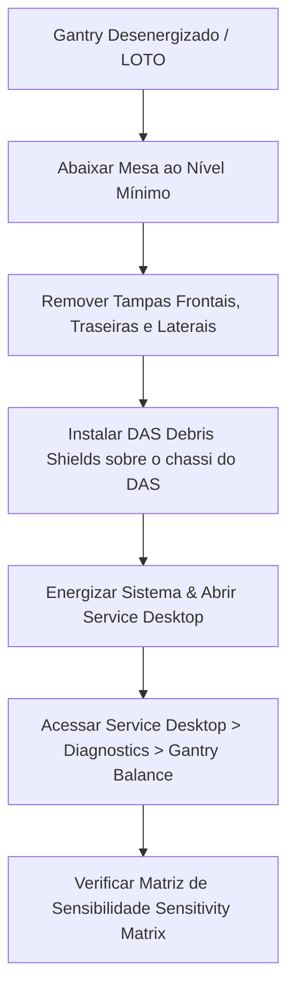

# INSTRUÇÃO DE TRABALHO (IT-TOMO-GE-004)

|  | **EMED ELETROMEDICINA LTDA.** **Engenharia Clínica & Diagnóstico por Imagem** CNPJ: 03.611.974/0001-08 | **CÓDIGO:** `IT-TOMO-GE-004` **VERSÃO:** `2.4 Homologada` **REVISÃO:** `Rev. 02 (26/10/2026)` **NORMA:** `ANVISA RDC 611` |
|:---:|:---|:---|

---

## Balanceamento Estático & Dinâmico do Gantry (Gantry Balance Procedure)
### Tomógrafos GE Healthcare (Linhas BrightSpeed Lite / Select & Brivo CT385)

---

### 1. OBJETIVO & ESCOPO
Padronizar a execução do procedimento de balanceamento estático e dinâmico do Gantry rotativo após intervenções mecânicas de grande porte, tais como:
* Substituição do Tubo de Raio-X;
* Substituição ou reparo no Colimador;
* Troca do Inversor de Alta Tensão (HV Inverter) ou Gerador JEDI;
* Troca ou manutenção no DAS (Data Acquisition System) ou Detector;
* Substituição de contrapesos ou rolamento principal do Gantry.

> [!WARNING]
> **PERIGO DE IMPACTO & PROJÉTEIS (CENTRIFUGAL HAZARD):**
> O conjunto rotativo do Gantry opera com rotações de até $0.5\text{ s}$ por volta ($120\text{ RPM}$), gerando acelerações centrífugas extremas. **Todos os fixadores dos contrapesos DEVEM ser rigorosamente apertados com torquímetro certificado.** Fixadores soltos provocarão o desprendimento de blocos de chumbo/aço em alta velocidade, resultando em destruição catastrófica do equipamento e risco fatal para operadores.

---

### 2. FERRAMENTAS, INSTRUMENTOS & PEÇAS OBRIGATÓRIAS
* **Kit de Contrapesos GE (Gantry Balance Weight Kit):** P/N `2381045`;
* **Protetores de Resíduos do DAS (DAS Debris Shields):** (Inclusos no Kit de Balanceamento);
* **Torquímetro de Alta Capacidade com Encaixe 1/2" drive (até 250 ft-lbs / 340 N·m):** P/N `46-268521G1`;
* **Torquímetro Padrão de Campo (Kit 46-268445G1):** Para torques médios e baixos;
* **Soquete Longo Sextavado 1/2" (Deep Well Socket):** Para porcas das barras roscadas;
* **Nível Magnético Digital / Inclinômetro de Precisão**;
* **Equipamentos de Proteção Individual (EPI):** Óculos de proteção, calçado de segurança com biqueira e luvas mecânicas.

---

### 3. POSICIONAMENTO E PREPARAÇÃO DO EQUIPAMENTO

#### 3.1 Instalação do DAS Debris Shield
* **ATENÇÃO CRÍTICA:** Antes de manusear pesos ou parafusar suportes, instale obrigatoriamente os **DAS Debris Shields** de proteção sobre o conjunto de placas do DAS. Isso impede que limalhas metálicas, lascas de rosca ou arruelas caiam dentro do chassi eletrônico.
* Os shields podem permanecer instalados com as ventoinhas do DAS em funcionamento durante a preparação, mas **DEVEM SER REMOVIDOS antes de iniciar os testes de rotação rápida do Gantry**.

---

### 4. GEOMETRIA DOS CONTRAPESOS E PILHAS (WEIGHT STACKS)
Os pesos de balanceamento são distribuídos em duas posições angulares principais no anel rotativo:
1. **Posição 78 Graus ($78^\circ$)**: Composta por placas balanceadoras fixadas por 2 porcas M12 e 2 parafusos M12 de cabeça sextavada.
2. **Posição 180 Graus ($180^\circ$)**: Composta por 4 barras roscadas de alta resistência onde se empilham espaçadores e calços de aço/alumínio.

#### 4.1 Identificação e Ordenação Rígida das Placas
* A ordem física das placas é descrita pelo software como **Inner to Outer** (da parte traseira mais próxima do rolamento em direção à frente/mesa).
* Cada placa possui gravação a laser indicando:
  * **Metal Base:** `Steel` (Aço) ou `Aluminum` (Alumínio);
  * **Tipo:** `WEIGHT`, `SPACER` ou `SHIM`;
  * **Posição:** `78 DEG` ou `180 DEG`;
  * **Espessura em mm:** Exemplo: `25.4MM`, `12.7MM`, `6.3MM`, `3.2MM`.
* **A orientação dos furos deslocados:** No espaçador de $25,4\text{ mm}$ e calço de $3,2\text{ mm}$ a $180^\circ$, os furos são deslocados para uma das bordas. Eles **devem ser montados com os furos mais próximos da borda virados para baixo (em direção ao DAS)**.

---

### 5. PROCEDIMENTO DE EXECUÇÃO DO SOFTWARE (SERVICE DESKTOP)

1. **Inicialização do Módulo:**
   * No console do operador (Host Z800 / xw8600), abra o **Service Desktop**;
   * Navegue até a aba **Diagnostics** $\rightarrow$ **Gantry Balance Program**;
   * Clique no botão **Run**.

2. **Geração da Matriz de Sensibilidade (Sensitivity Matrix):**
   * Se for a primeira inicialização após troca de componentes estruturais ou se a matriz estiver ausente/corrompida, o sistema solicitará:
     * Digitação da configuração atual dos pesos instalados (insira a quantidade exata de cada calço em $78^\circ$ e $180^\circ$; digite `0` se não estiver presente);
     * Instalação do **Trial Weight A** (Peso de Teste A) na posição de $180^\circ$, posicionado sobre as porcas existentes (utilizando os furos rebaixados do peso de teste);
     * O sistema executa um giro lento de calibração;
     * O sistema solicita a remoção do Trial Weight A e a instalação do **Trial Weight B**;
     * Concluídos os dois giros de referência, a matriz vetorial é gerada e salva.

3. **Ciclos de Medição de Desbalanceamento Dinâmico:**
   * O software aciona o motor de rotação em passos progressivos de velocidade ($1.0\text{ s} \rightarrow 0.8\text{ s} \rightarrow 0.6\text{ s} \rightarrow 0.5\text{ s}$);
   * Os acelerômetros montados na carcaça estacionária registram as vibrações estáticas (plano único) e de torque dinâmico (couple unbalance);
   * O programa calcula e exibe na tela o relatório com a recomendação exata de placas a adicionar ou subtrair nas pilhas de $78^\circ$ e $180^\circ$.

4. **Iterações de Ajuste Físico:**
   * Bloqueie a rotação do Gantry;
   * Monte ou remova rigorosamente as placas indicadas pelo software;
   * Execute uma nova medição (**Run Verification**);
   * **Critério de Aprovação:**
     * `Balanced to Factory Specifications`: Padrão de excelência de fábrica atingido (finalizar).
     * `Balanced to Field Specifications`: Padrão de campo GE aceitável (tolerância máxima atendida).
     * `Gantry is NOT Balanced`: Requer mais uma iteração. Se após 3 tentativas não convergir, revise se a espessura digitada confere exatamente com as peças físicas ou regenere a matriz de sensibilidade.

---

### 6. TABELA DE TORQUES ESPECÍFICOS (OBRIGATÓRIO)

| Posição Angular | Fixador / Componente | Ferramenta Necessária | Torque Especificado (N·m) | Torque em ft·lb |
| :--- | :--- | :--- | :---: | :---: |
| **$180^\circ$** | **4 Porcas das Barras Roscadas** | Torquímetro 1/2" + Soquete Longo | **$160,0\text{ N}\cdot\text{m}$** | $118,0\text{ ft}\cdot\text{lb}$ |
| **$78^\circ$** | **2 Porcas M12** | Torquímetro Padrão | **$44,5\text{ N}\cdot\text{m}$** | $32,8\text{ ft}\cdot\text{lb}$ |
| **$78^\circ$** | **2 Parafusos Sextavados M12** | Torquímetro Padrão | **$66,4\text{ N}\cdot\text{m}$** | $48,9\text{ ft}\cdot\text{lb}$ |
| **Mancais / Sensores**| Parafusos M6 / M8 de fixação de suporte | Torquímetro de precisão | **$9,5\text{ N}\cdot\text{m}$ / $23,0\text{ N}\cdot\text{m}$** | $7,0 / 17,0\text{ ft}\cdot\text{lb}$ |

> [!IMPORTANT]
> **PADRÃO DE APERTO CRUZADO (DIAGONAL PATTERN):**
> Devido à elasticidade residual do empilhamento de placas (springiness), ao apertar uma porca a $160\text{ N}\cdot\text{m}$, as porcas adjacentes sofrem leve folga. **É OBRIGATÓRIO apertar em cruz (1 - 3 - 2 - 4) e repetir a passagem com o torquímetro em todas as porcas 3 vezes consecutivas** até que nenhuma porca gire antes do clique do torquímetro.

---

### 7. FINALIZAÇÃO, VERIFICAÇÃO DE QA & LIBERAÇÃO
1. **Limpeza Geral:**
   * Remova os *DAS Debris Shields*;
   * Inspecione visualmente com lanterna $360^\circ$ do anel rotativo e bandeja inferior em busca de arruelas, porcas ou ferramentas esquecidas.
2. **Reinstalação de Coberturas:**
   * Recoloque as tampas laterais, superiores, frontais e traseiras com todos os parafusos;
   * Verifique o alinhamento da janela de mylar (Mylar Window).
3. **Teste de Liberação em Rotação Contínua:**
   * Realize o procedimento **FASTCAL** no console;
   * Execute 5 giros estacionários e 10 giros dinâmicos a $0.5\text{ s}$ com emissão de Raio-X;
   * Abra o log do sistema (`gesyslog`) e confirme a inexistência de códigos de erro de vibração excessiva ou ruído acústico anormal.
4. **Assinatura da OS:**
   * Registre no chamado da eMED o status do balanceamento (`Field Spec` ou `Factory Spec`), os valores residuais e o torque aplicado.
