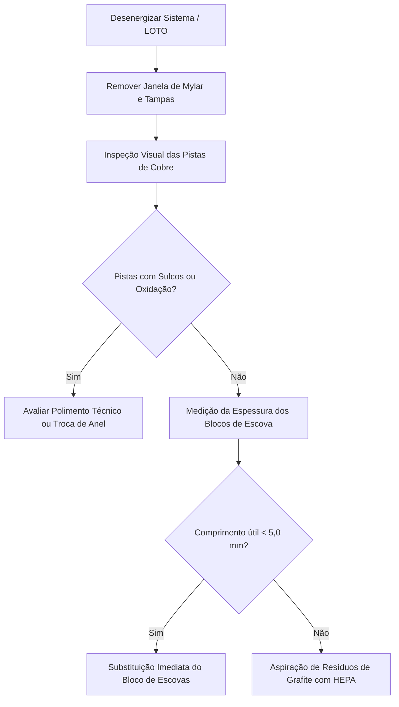

# INSTRUÇÃO DE TRABALHO (IT-TOMO-GE-005)
## Diagnóstico, Manutenção e Alinhamento do Slip Ring & Antena HSDCD
### Tomógrafos GE Healthcare (BrightSpeed Series, Select & Brivo CT385)

---

### 1. OBJETIVO & CAMPO DE APLICAÇÃO
Estabelecer o procedimento padrão para inspeção, higienização de pistas, aferição de desgaste de blocos de escovas de grafite, medição de tensões de alimentação e alinhamento do canal de alta velocidade HSDCD (*High Speed Data Channel Device*) em tomógrafos computadorizados GE Healthcare.

> [!CAUTION]
> **PERIGO DE CHOQUE ELÉTRICO & ARCO VOLTAICO (750V DC / 120V AC):**
> O conjunto de pistas do Slip Ring conduz tensões letais de **$750\text{V DC}$** para alimentação dos inversores de Raio-X e **$120\text{V AC}$** para eletrônica embarcada. **O desligamento geral do disjuntor principal da PDU e aplicação do procedimento LOTO (Lockout / Tagout) são obrigatórios antes de qualquer contato físico ou abertura de tampas.**

---

### 2. FERRAMENTAS, INSTRUMENTOS & INSUMOS EXIGIDOS
* **Aspirador Técnico Antiestático com Filtro HEPA Absoluto** (Proibido uso de ar comprimido!);
* **Ferramenta Calibrada de Ajuste HSDCD (HSDCD Adjustment Tool - P/N GE)** com espessura nominal de **$1,41\text{ mm}$ ($0.060"$)**;
* **Paquímetro Digital de Precisão (0 a 150 mm, resolução 0.01 mm)**;
* **Relógio Comparador com Base Magnética Articulada** (para checagem de excentricidade/empenamento);
* **Multímetro Digital True-RMS Calibrado** (Categoria CAT III 1000V / CAT IV 600V);
* **Álcool Isopropílico Grau Eletrônico ($\ge 99,8\%$)**;
* **Toalhas Técnicas de Não-Tecido Isentas de Fiapos (Lint-Free Wipes / WypAll / Kimwipes)**;
* **Luvas Antiestáticas ESD (Nitrílicas)**.

---

### 3. AVALIAÇÃO DE DESGASTE DAS ESCOVAS & ESTADO DAS PISTAS



#### 3.1 Limites Críticos de Substituição das Escovas
1. **Comprimento Mínimo:** Medir o comprimento remanescente de carbono em cada bloco de escovas (Alta Tensão, Baixa Tensão e Terra). Se qualquer escova apresentar **menos de $5,0\text{ mm}$ de grafite útil**, o conjunto do bloco deve ser trocado preventivamente.
2. **Cordoalha de Cobre:** Verifique se o rabicho de cobre trançado está a menos de $1,5\text{ mm}$ de tocar o porta-escovas. Se encostar, haverá centelhamento e curto-circuito na pista.
3. **Pressão das Molas:** Checar se as molas espirais de pressão mantêm pressão uniforme sobre o dorso do bloco. Molas frouxas geram faíscas dinâmicas (*micro-arcos*) que degradam o sinal de imagem gerando anéis e ruído no tomograma.

#### 3.2 Limpeza e Descontaminação de Grafite
* **REGRA DE OURO:** **NUNCA UTILIZE AR COMPRIMIDO!** O jato de ar dispersa o pó condutor de grafite por todo o interior do Gantry, contaminando barramentos de potência e os circuitos sensíveis dos canais analógicos do DAS.
* Utilize o aspirador técnico com bico plástico estreito equipado com filtro HEPA.
* Passe panos *lint-free* umedecidos levemente em **álcool isopropílico $99,8\%$** ao longo das pistas rotativas, girando o Gantry manualmente. Repita até o pano sair totalmente limpo. Aguarde evaporação completa de 10 minutos antes de energizar.

---

### 4. ALINHAMENTO GEOMÉTRICO DA ANTENA HSDCD (RECEPTOR RF)

A transmissão de dados brutos de imagem (Raw Data) do conjunto detector rotativo para o console fixo ocorre por rádiofrequência através da antena receptora HSDCD estacionária e trilha emissora rotativa no anel do Slip Ring.

```
       [ Antena Receptora HSDCD (Estacionária) ]
       -----------------------------------------
                     ^
                     | GAP DE AR = 1,41 mm (0.060 pol)
                     v
       =========================================
       [ Trilha Emissora de RF no Slip Ring (Rotativo) ]
```

#### 4.1 Passo a Passo do Ajuste do Air-Gap
1. Com o sistema desenergizado e desligado na PDU, acesse o suporte da antena HSDCD.
2. Afrouxe os parafusos de fixação radial e os parafusos de alinhamento axial da antena.
3. Insira cuidadosamente a **Ferramenta de Calibração HSDCD (calibre de $1,41\text{ mm}$ / $0.060"$)** no vão entre a face da antena receptora e a superfície da trilha emissora no anel. O calibre deve deslizar de forma justa (sem folga perceptível e sem forçar).
4. Pressione levemente o topo do conjunto da antena para baixo contra o calibre enquanto reaperta os parafusos radiais.
5. Remova a ferramenta de ajuste deslizando-a lateralmente.
6. Centralize a antena em relação à trilha condutora central utilizando as miras de alinhamento ótico (*alignment sights*) existentes em ambas as extremidades do corpo da antena.
7. Aperte firmemente os parafusos axiais mantendo a centralização.
8. Encoste os parafusos manuais recartilhados (*Axial Thumbscrews*) no chassi da antena para travar a posição de referência futura.

> [!WARNING]
> **RISCO DE DESTRUIÇÃO DO ANEL SLIP RING:**
> **JAMAIS gire o Gantry com a ferramenta de ajuste instalada no entreferro!** As trilhas de RF na placa de circuito impresso do anel serão irreversivelmente danificadas por cisalhamento mecânico. Não há reparo em campo para trilhas rompidas do anel (exige substituição completa do anel rotativo Slip Ring).

#### 4.2 Verificação de Batimento / Empenamento (Run-Out)
Gire o Gantry manualmente através de uma volta completa ($360^\circ$) enquanto monitora o espaço livre entre a antena e o anel rotativo:
* **Batimento Axial Máximo Admissível:** $\le \mathbf{0,83\text{ mm}}$;
* **Batimento Radial Máximo Admissível:** $\le \mathbf{0,81\text{ mm}}$;
* Em nenhuma hipótese a antena receptora pode tocar na pista rotativa, mesmo sob inclinação máxima do Gantry ($\pm 30^\circ$ de Tilt).

---

### 5. MEDIÇÃO DAS FONTES DE ALIMENTAÇÃO DO HSDCD

Com as tampas ainda abertas e procedimentos de segurança para trabalho sob tensão energizada:
1. **Transmissor Rotativo (HSDCD Transmitter):**
   * Ponto de Medição: Fios de alimentação provenientes da Fuse Box Assembly do anel rotativo;
   * **Tensão Nominal Requerida:** **$+15,0\text{V DC} \pm 2,0\text{V DC}$**;
   * Verifique se os LEDs de atividade do transmissor acendem em verde estático.
2. **Receptor Estacionário (HSDCD Receiver):**
   * Ponto de Medição: Fios de alimentação fixados na traseira do conjunto da ventoinha direita;
   * **Tensão Nominal Requerida:** **$+15,0\text{V DC} \pm 2,0\text{V DC}$**;
   * LED 1: Status de Alimentação (+15V OK);
   * LED 2: Sinal de Transmissão de RF Presente (Transmitting OK).

---

### 6. VALIDAÇÃO DINÂMICA VIA DIAGNÓSTICO (DIP STATS)

Para assegurar que não há perdas de pacotes ou ruído eletromagnético introduzido pelo Slip Ring durante a rotação:
1. No Service Desktop, abra o utilitário de estatísticas **DIP Stats** (Data Ingestion Pipeline);
2. Anote os valores atuais de:
   * `Raw Ring Error Count`;
   * `FEC Correctable Counts` (Forward Error Correction);
   * Data e hora do último update de arquivo.
3. No painel de exame, realize uma rotina de estresse com emissão de Raio-X:
   * **5 Exposições Estacionárias (Axiais)**;
   * **50 Exposições Rotativas Contínuas** (qualquer protocolo padrão de crânio/abdome).
4. **Feche o exame** (o encerramento do protocolo é o gatilho que grava o arquivo de dump de estatísticas do DIP).
5. Reabra o **DIP Stats** e confira:
   * O incremento de `Raw Ring Errors` deve ser rigorosamente **ZERO (0)**;
   * O incremento de eventos corrigidos `FEC Correctable` deve ser **ZERO (0)**.
6. Reinstale a janela de Mylar e todas as tampas do Gantry com torque adequado.
