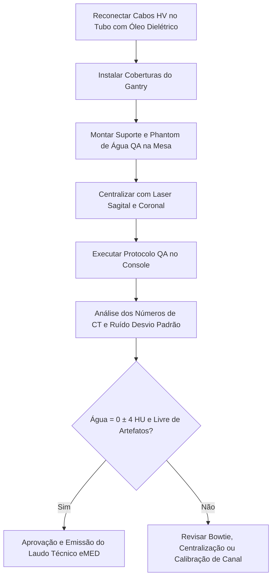

# INSTRUÇÃO DE TRABALHO (IT-TOMO-GE-008)
## Verificação Elétrica do Tanque HV, Calibração de Medidores & Teste Final de QA
### Tomógrafos GE Healthcare (Brivo CT385, BrightSpeed e Optima Series)

---

### 1. OBJETIVO & APLICAÇÃO
Padronizar a verificação dos divisores e resistores de realimentação (*feedback resistors*) do Tanque de Alta Tensão (HV Tank), a aferição dos circuitos medidores de kV/mA e a realização do Teste de Garantia da Qualidade (QA Test) com phantom de água para liberação clínica do equipamento.

---

### 2. FERRAMENTAS & INSTRUMENTOS EXIGIDOS
* **Osciloscópio Digital Portátil (Mínimo 100 MHz, 2 canais isolados)** com pontas de prova 10X compensadas;
* **Divisor de Alta Tensão de Teste (HV Bleeder) com cabo terra para o chassi GND do Gantry**;
* **Chave de Gancho / Spanner Wrench para anéis de travamento dos cabos de alta tensão**;
* **Phantom de QA de Água GE (QA Phantom)** e suporte de mesa;
* **Óleo dielétrico de reposição e panos sem fiapos (*lint-free*)**.

---

### 3. PROCEDIMENTO 1: VERIFICAÇÃO DOS RESISTORES DE FEEDBACK DO TANQUE HV

```
                 [ Tanque de Alta Tensão (HV Tank) ]
                                |
             +------------------+------------------+
             |                                     |
       [ Polo Catódico (-) ]                 [ Polo Anódico (+) ]
       (Cabo HV do Filamento)                (Cabo HV do Ânodo)
             |                                     |
             +---------> [ Divisor / Bleeder ] <---+
                                |
                   (GND ao Chassi do Gantry)
```

> [!CAUTION]
> **CONEXÃO DE ATERRAMENTO CRÍTICA:**
> O cabo de terra do Bleeder de Alta Tensão **DEVE estar firmemente parafusado à barra de terra (GND) do chassi do Gantry**. Disparar o gerador com o divisor sem aterramento destruirá instantaneamente a placa CT Interface e os conversores A/D do gerador!

#### 3.1 Preparação e Conexão de Teste
1. Desenergize o Gantry e execute o procedimento LOTO na PDU.
2. Trave a rotação mecânica do Gantry na posição de serviço.
3. Com a chave de gancho (*spanner wrench*), solte os anéis de travamento dos cabos de alta tensão no tubo.
4. Puxe os terminais dos cabos HV (Ânodo e Cátodo) com cuidado em linha reta e limpe o excesso de óleo dielétrico.
5. Conecte os terminais ao Divisor de Teste (HV Bleeder). Conecte o cabo terra do Bleeder ao terra do Gantry.
6. Na placa **CT Interface Board** (localizada na unidade de potência do Gantry):
   * Conecte a ponta de prova do Canal 1 ao ponto de teste **TP18 (`KV_N`)**;
   * Conecte a garra de terra da ponta ao ponto de teste **TP17 (`KV_GND`)**.
7. Ajuste a escala do osciloscópio:
   * **Base de Tempo:** $200\text{ ms/div}$;
   * **Escala Vertical:** $10\text{V/div}$ (com ponta atenuadora 10X).

#### 3.2 Execução do Disparo Diagnóstico
1. No Service Desktop, configure os parâmetros de exposição:
   * `Gantry Rotation`: **Disabled (Estacionário)**;
   * `Focal Spot`: **Large**;
   * `kV`: **100 kV**;
   * `mA`: **50 mA**;
   * `Tempo de Exposição`: **$1,0\text{ s}$ ($1000\text{ ms}$)**.
2. Efetue o disparo de Raio-X a partir do console.
3. No osciloscópio, congele a forma de onda (*Single Capture*) e verifique:
   * **Tempo de Subida (*Rise Time*):** Estabilização rápida em menos de $15\text{ ms}$ sem oscilações amortecidas;
   * **Amplitude do Patamar:** Deve corresponder à relação de conversão nominal do divisor ($\pm 2\%$);
   * **Tempo Total de Exposição ($\Delta t$):** $1000\text{ ms} \pm 2\text{ ms}$.

---

### 4. PROCEDIMENTO 2: TESTE FINAL DE GARANTIA DA QUALIDADE (QA TEST)

O QA Test é o protocolo oficial que valida a integridade diagnóstica do feixe antes da entrega do equipamento ao corpo clínico do hospital.



#### 4.1 Passo a Passo do Teste de QA
1. Reinstale os cabos HV no tubo (aplique camada nova de óleo isolante para expulsar o ar dos receptáculos).
2. Trave os anéis com a chave de gancho e recoloque todas as tampas do Gantry.
3. Posicione o suporte do phantom na cabeceira da mesa do paciente.
4. Instale o **Phantom Cilíndrico de Água** e alinhe o centro exato com as cruzes laser de posicionamento interno e externo.
5. No software clínico (ImageWorks / Exam Browser):
   * Selecione o exame de controle de qualidade: **`QA Examination`**;
   * Pressione **[Move to Scan]** e em seguida **[Start]** no console;
   * O sistema executará a varredura automática multislice em diferentes níveis de kV ($80, 100, 120, 140\text{ kV}$) e espessuras de corte.

#### 4.2 Critérios Rigorosos de Aceitação eMED / GE

| Parâmetro Medido | Região de Interesse (ROI) | Especificação de Fábrica | Tolerância de Campo eMED |
| :--- | :--- | :--- | :--- |
| **Número de CT da Água** | Centro do phantom ($200\text{ mm}^2$) | $\mathbf{0,0\text{ HU}} \pm 3,0\text{ HU}$ | $\mathbf{0,0\text{ HU}} \pm \mathbf{4,0\text{ HU}}$ |
| **Ruído da Imagem (Desvio Padrão - SD)** | ROI central em corte de 5 mm | $< 3,8\text{ HU}$ | $\le 4,2\text{ HU}$ |
| **Uniformidade de Campo** | Diferença Centro vs. Periferia | $\Delta \le 3,0\text{ HU}$ | $\Delta \le 4,0\text{ HU}$ |
| **Artefatos Visuais** | Imagem inteira em janela estreita (W:100 / L:0) | **Zero anéis concêntricos ou faixas** | **Sem linhas de centelhamento (*streaks*)** |

---

### 5. FINALIZAÇÃO & ASSINATURA DA ORDEM DE SERVIÇO
* Salve a imagem do corte de QA no PACS ou gere o laudo em PDF para arquivamento no chamado do Sistema eMED;
* Preencha os valores obtidos de **HU Médio da Água** e **Desvio Padrão** no formulário digital de encerramento da OS;
* Equipamento 100% liberado para exames diagnósticos.
