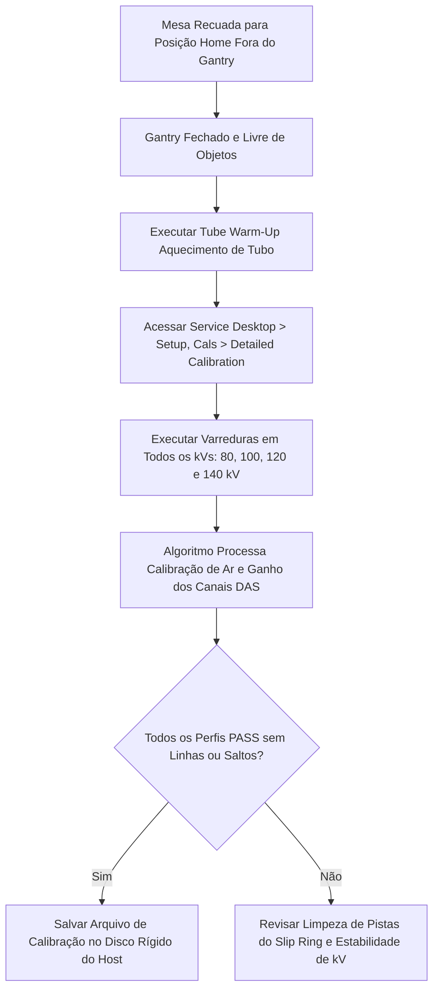

# INSTRUÇÃO DE TRABALHO (IT-TOMO-GE-011)

|  | **EMED ELETROMEDICINA LTDA.**<br>**Engenharia Clínica & Diagnóstico por Imagem**<br>CNPJ: 03.611.974/0001-08 | **CÓDIGO:** `IT-TOMO-GE-011`<br>**VERSÃO:** `2.4 Homologada`<br>**REVISÃO:** `Rev. 02 (26/10/2026)`<br>**NORMA:** `ANVISA RDC 611` |
|:---:|:---|:---|

---


## Calibração das Aberturas do Colimador & Calibração Detalhada do Sistema (Detailed Calibration)
### Tomógrafos GE Healthcare (Linhas Brivo CT385 e BrightSpeed Series)
*Baseado nos manuais oficiais GE Direction 5438996-8EN / 5181178 (Procedimentos Oficiais 12 e 13)*

---

### 1. OBJETIVO & ESCOPO
Padronizar a calibração eletromecânica dos atuadores de fatiamento do colimador (*Aperture Calibration*) e a execução da **Calibração Detalhada do Sistema (Detailed Calibration)**, que mapeia a sensibilidade de todos os canais do detector multislice para todos os modos de corte clínico ($0.625\text{ mm}$ a $10\text{ mm}$).

---

### 2. FERRAMENTAS & REQUISITOS PRELIMINARES
* Sala de exames climatizada com temperatura estabilizada entre **$20^\circ\text{C}$ e $24^\circ\text{C}$**;
* Tubo de Raio-X aquecido (*Tube Warm-up* realizado há menos de 1 hora);
* Phantom de Calibração de Ar GE (*Air Calibration Space* desobstruído - mesa recuada e sem nenhum objeto dentro do túnel do gantry).

---

### 3. PROCEDIMENTO 1: CALIBRAÇÃO DAS ABERTURAS DO COLIMADOR (COLLIMATOR CALIBRATION)

```
                           [ Servomotor do Colimador ]
                                        |
                 +----------------------+----------------------+
                 |                                             |
       [ Came de Abertura Primária ]                 [ Came de Abertura Secundária ]
       (Espessura de Fatias / Blades)                (Rejeição de Penumbra)
```

1. No Service Desktop, selecione a aba **Setup, Cals** $\rightarrow$ **Collimator Calibration**.
2. Pressione **[Start]**:
   * O software aciona os cames das lâminas de colimação até as chaves de fim de curso ópticas (*Home Flags*);
   * Em seguida, o motor comuta cada espessura de corte nominal:
     * Fatia de $0,625\text{ mm}$ (Sub-milimétrico);
     * Fatia de $1,25\text{ mm}$;
     * Fatia de $2,50\text{ mm}$;
     * Fatia de $5,00\text{ mm}$;
     * Fatia de $10,0\text{ mm}$.
3. Para cada passo, o feixe de RX é emitido para medir a penumbra e o perfil de intensidade nos canais limítrofes do detector.
4. **Critério de Aceitação:** A centralização das lâminas em relação ao feixe não pode apresentar assimetria superior a **$2\%$**.
5. Clique em **[Save Calibration]** para gravar os pulsos de contagem dos motores de passo na placa controladora do colimador (CCB).

---

### 4. PROCEDIMENTO 2: CALIBRAÇÃO DETALHADA DO SISTEMA (DETAILED CALIBRATION)

A calibração detalhada é a base do algoritmo de reconstrução tomográfica da GE. Ela elimina artefatos em anel e garante a exatidão das densidades radiológicas (escala de Hounsfield - HU).



#### 4.1 Passo a Passo da Detailed Calibration
1. Recue a mesa totalmente para fora do Gantry (*Full Out*);
2. No Service Desktop, clique em **[Detailed Calibration]**;
3. Marque todas as combinações clínicas de tensão de tubo:
   * **$80\text{ kV}$**, **$100\text{ kV}$**, **$120\text{ kV}$** e **$140\text{ kV}$**;
   * Pontos focais: **Small Focus** e **Large Focus**;
4. Pressione o botão **[Scan]** no console;
5. O sistema executará aproximadamente **40 a 60 varreduras consecutivas** em rotação;
6. **Acompanhamento na Tela:** O software exibe as curvas de ganho de cada um dos milhares de canais do detector multislice.
7. **Critério de Aprovação:**
   * Nenhum canal com ganho fora da curva limite (*Dead Channels* ou *Noisy Channels*);
   * Relatório final com status **COMPLETED SUCCESSFULLY**.
8. Clique em **[Save]** e execute um **FASTCAL** de rotina para validar a atualização dos vetores de calibração.
