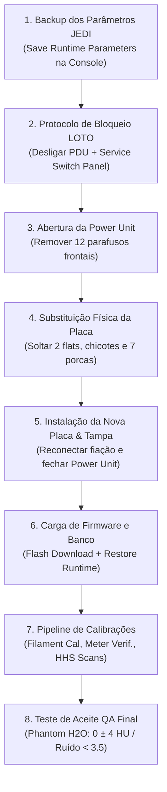
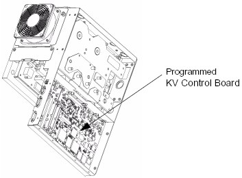

# INSTRUÇÃO DE TRABALHO TÉCNICA - eMED BIOMEDICAL

|  | **EMED ELETROMEDICINA LTDA.** **Diagnóstico por Imagem** CNPJ: 03.611.974/0001-08 | **CÓDIGO:** `IT-TOMO-GE-013` **VERSÃO:** `2.4 Homologada` **REVISÃO:** `Rev. 02 (26/10/2026)` **NORMA:** `ANVISA RDC 611` |
|:---:|:---|:---|

---

## IT-TOMO-GE-013: Substituição da Placa Controladora de Alta Tensão (Programmed KV Control Board)
**Sistema:** Tomógrafo Computadorizado GE BrightSpeed (Lite, Select, 16, Ultra, Plus)  
**Subsistema:** Gantry / Geração de Alta Tensão / Power Unit (Gerador JEDI)  
**Componente:** Programmed KV Control Board (Placa de Controle de kV JEDI)  
**Documento Base de Fábrica:** GE Direction 5181178-800 Rev. 16 (Section 1074628)  
**Nível Técnico:** Diagnóstico por Imagem Especializada / Nível 3 (Alta Tensão & Gantry)  
**Revisão:** 1.0 - Procedimento de Substituição, Flash Firmware e Revalidação  

---

### 1. OBJETIVO E ESCOPO
Padronizar a rotina técnica de substituição física da **Placa Controladora de kV Programada (*Programmed KV Control Board*)**, localizada no interior da unidade de potência (*Power Unit*) do Gantry dos tomógrafos GE da família BrightSpeed, abrangendo o backup de dados prévio, procedimentos de desenergização e segurança LOTO, instalação mecânica, recarga de firmware (*Flash Download*), parametrização via *JEDI Generator Tool* e o pipeline completo de calibrações e testes de controle de qualidade para liberação clínica.

---

### 2. REQUISITOS DE TEMPO, PESSOAL E FERRAMENTAL

* **Equipe Necessária:** 1 Engenheiro de Campo / Especialista de Tomografia.
* **Tempo de Procedimento Mecânico:** ~30 a 45 minutos.
* **Tempo de Inicialização, Firmware & Calibrações:** ~2 horas.

#### Ferramentas Obrigatórias em Campo:
| Item | Ferramenta / Insumo | Função Específica |
| :---: | :--- | :--- |
| **1** | Pulseira e Manta Antiestática (ESD) com garra jacaré | Proteção obrigatória contra descargas eletrostáticas nos CIs da placa |
| **2** | Jogo de Chaves Allen Métricas (com cabo T ou catraca) | Desaperto das tampas do Gantry e blindagens internas |
| **3** | Chave Soquete / Canhão Sextavada para porcas de fixação | Remoção das **7 porcas** de sustentação da KV Control Board |
| **4** | Chave Sextavada para parafusos da Power Unit | Remoção dos **12 parafusos** da tampa frontal da Power Unit |
| **5** | Multímetro Digital True-RMS CAT III 1000V calibrado | Confirmação de ausência de tensão no barramento HVDC |
| **6** | Kit LOTO (Cadeado, garra de travamento e cartão de bloqueio) | Bloqueio de segurança no disjuntor geral da PDU |
| **7** | Phantom de Calibração de Água (QA Phantom GE) | Teste final de aceite e qualidade de imagem ($0 \pm 4\text{ HU}$) |

---

### 3. AVISOS CRÍTICOS DE SEGURANÇA ELÉTRICA (LOTO)

> [!CAUTION]
> **PERIGO DE ELETROCUSSÃO POR ALTA TENSÃO RESIDUAL (ATÉ 750V DC / 140 kV):**  
> A unidade de potência do Gantry (*Power Unit*) opera com barramentos de corrente contínua de até $750\text{V DC}$ provenientes do inversor e capacitores de filtro, além da alta tensão gerada pelo tanque ($140\text{ kV}$).  
> **NUNCA** abra a Power Unit sem antes cumprir integralmente o procedimento de travamento elétrico (LOTO) e desligamento das 3 chaves do Service Switch Panel.

---

### 4. PROCEDIMENTO PASSO A PASSO

#### ETAPA 1: Pré-Requisito de Software — Backup dos Parâmetros de Runtime (JEDI Database)
> [!IMPORTANT]
> A placa controladora de kV armazena a base de dados interna do gerador JEDI, contendo o histórico de Tracking and Trending (TnT) do tubo e do gerador, além dos parâmetros de sintonia fina. Se a placa defeituosa ainda se comunicar com o console, efetue o backup antes de desligar o equipamento. Caso a placa esteja completamente queimada/incomunicável, prossiga para o desligamento (será carregada a base default na Etapa 5).

1. No console do operador (Host Computer), abra o **Common Service Desktop**.
2. Clique na aba superior **`[CALIBRATION]`** $\rightarrow$ selecione **`[X-RAY GENERATION]`** $\rightarrow$ abra o **`[Generator Tool - JEDI]`**.
3. Na Coluna 3 (**Database Management**):
   - Clique no botão **`[Save Runtime Parameters]`**.
   - O sistema fará o upload dos dados da NVRAM da placa KV Control para um arquivo protegido no disco rígido do console.
   - Aguarde a mensagem de confirmação: `Runtime parameters saved successfully`.
4. Feche o Generator Tool.

---

#### ETAPA 2: Desenergização e Bloqueio de Segurança (LOTO)
1. Acione a mesa de exames e abaixe-a até a **elevação mínima** para desobstruir o campo de trabalho frontal.
2. Desligue o disjuntor principal da Tomografia na **PDU (Power Distribution Unit)** e aplique o cadeado e cartão de bloqueio LOTO.
3. Remova as tampas plásticas superior, laterais e frontal do Gantry.
4. No painel de chaves de serviço do Gantry (**Service Switch Panel**), desligue as **3 chaves seletoras**:
   - Chave 1: **Axial Drive** (Motor de rotação do Gantry) $\rightarrow$ **OFF**
   - Chave 2: **HVDC** (Barramento de Alta Tensão DC) $\rightarrow$ **OFF**
   - Chave 3: **120VAC** (Alimentação auxiliar de comando) $\rightarrow$ **OFF**
5. Aguarde no mínimo 5 minutos para descarga natural dos capacitores e comprove com multímetro a ausência de tensão nos barramentos de potência.

---

#### ETAPA 3: Remoção Física da KV Control Board Defeituosa
1. Coloque a **pulseira antiestática (ESD)** e conecte a garra jacaré em um ponto metálico não pintado do chassi do Gantry.
2. Localize a **Power Unit** (conjunto do inversor de alta tensão montado na estrutura giratória do Gantry).
3. Utilizando a chave apropriada, desparafuse os **12 parafusos sextavados** de fixação da tampa frontal de blindagem da Power Unit e retire a tampa com cuidado.
4. Identifique a **KV Control Board** instalada no compartimento frontal:
   - Desconecte com cuidado os **2 cabos flat tipo fita (*ribbon cables*)** conectados à placa, pressionando as abas plásticas laterais dos conectores.
   - Identifique e desconecte todos os conectores de chicotes elétricos discretos plugados na placa.
5. Com a chave canhão sextavada, desrosqueie as **7 porcas de retenção** que fixam a placa aos espaçadores metálicos roscados.

6. Puxe a placa cuidadosamente para fora, segurando apenas pelas bordas laterais.
7. Guarde a placa substituída dentro da bolsa blindada antiestática para envio ao laboratório.

---

#### ETAPA 4: Instalação Física da Nova Programmed KV Control Board
1. Retire a nova **KV Control Board** da embalagem blindada com os devidos cuidados ESD.
2. Compare visualmente a nova placa com a antiga, conferindo se os códigos de revisão, conectores e eventuais jumpers de hardware estão rigorosamente na mesma posição.
3. Posicione a nova placa sobre os 7 espaçadores roscados da Power Unit.
4. Instale e aperte as **7 porcas de retenção**, aplicando torque uniforme e firme (sem excesso para não danificar o circuito impresso).
5. Reconecte com precisão todos os chicotes de fiação nos seus respectivos soquetes, certificando-se de ouvir o clique de travamento de cada conector.
6. Reconecte os **2 cabos flat (*ribbon cables*)**, garantindo alinhamento perfeito dos pinos e travamento das presilhas plásticas.
7. Recoloque a tampa frontal de proteção da Power Unit e fixe os **12 parafusos sextavados**, garantindo a blindagem eletromagnética do inversor.
8. Retorne as 3 chaves do **Service Switch Panel** para a posição **ON** (`Axial Drive`, `HVDC` e `120VAC`).
9. Retire o cadeado LOTO da PDU e religue a alimentação geral do sistema.

---

#### ETAPA 5: Download de Firmware (Flash Download) & Restauração de Parâmetros
1. Aguarde a inicialização completa do console de comando e do software do sistema.
2. **Carga do Firmware na NVRAM (Flash Download):**
   - No *Common Service Desktop*, acesse o menu de utilitários de diagnóstico e selecione **`[FLASH Download]`**.
   - Selecione os arquivos de nó do gerador JEDI / KV Control.
   - Execute o download do software: os dados serão transmitidos do disco do console e gravados na memória flash da nova placa.
   - Ao término, o sistema solicitará o reset dos nós; confirme o procedimento e aguarde a reinicialização dos controladores.
3. **Restauração da Base de Dados do Gerador:**
   - Acesse novamente o **`[Generator Tool - JEDI]`** via *Calibration* $\rightarrow$ *X-Ray Generation*.
   - Na Coluna 3 (**Database Management**):
     - **Se o backup foi realizado com sucesso na Etapa 1:** Clique no botão **`[Restore Runtime Parameters]`**. O sistema devolverá o histórico de TnT e os parâmetros customizados para a placa.
     - **Se a placa anterior estava inoperante (sem backup prévio):** Clique no botão **`[Initialize Database]`**. O sistema carregará a base padrão de fábrica (*default database*), estabelecendo os parâmetros de linha de base para nova caracterização.

---

#### ETAPA 6: Pipeline Obrigatório de Calibrações e Revalidação (Certified Retest Matrix)

> [!WARNING]
> A substituição da controladora de alta tensão altera a malha fechada de realimentação do gerador. A realização do pipeline de calibração abaixo é **obrigatória** segundo as normas técnicas da GE para garantir precisão dos níveis de kV, proteção contra arco e segurança do paciente.

1. **Gantry Rotation Safety Check:**
   - Execute a verificação de segurança de rotação do Gantry para confirmar que não há chicotes frouxos, interferências na Power Unit ou erros de chave de intertravamento.
2. **Gantry Balance Procedure:**
   - Verifique o balanceamento estático e dinâmico do Gantry caso tenha havido remoção de pesos ou deslocamento de componentes pesados da Power Unit.
3. **Meter Verification (Verificação dos Medidores de Corrente):**
   - Acesse o teste de verificação de medidores (*Meter Verification*) para validar os conversores A/D de leitura de corrente de tubo (mA) e tensão (kV) na placa.
4. **HV Tank Feedback Resistor Verification:**
   - Execute a verificação dos resistores de realimentação do tanque de alta tensão, validando a proporcionalidade de leitura das pontes divisoras dos semiciclos positivo e negativo.
5. **Filament Calibration (Calibração de Filamento):**
   - No *Generator Tool*, selecione **`[Filament Cal]`**.
   - Feche as portas da sala de exames.
   - Pressione e mantenha pressionado o botão de disparo **[Scan]** no console quando solicitado.
   - O sistema executará disparos sucessivos mapeando as curvas de aquecimento e corrente de emissão para o **Foco Fino (*Small Filament*)** e **Foco Grosso (*Large Filament*)**. Ambos devem finalizar com status verde `PASSED`.
6. **HHS Scans (High Heat Storage Scans):**
   - Selecione **`[HHS Scans]`** para executar uma bateria de varreduras em alta potência e alta rotação, condicionando a malha de controle térmico e atestando a estabilidade da nova placa sob carga pesada.
7. **System Scanning Test:**
   - Execute uma rotina completa de varredura helicoidal e axial no modo clínico para certificar que nenhum erro de timeout, comunicação ou arco elétrico ocorre.
8. **Quality Assurance Test (QA Test com Phantom de Água):**
   - Posicione o phantom oficial de calibração da GE no suporte da mesa e alinhe o plano de corte no centro da seção de água.
   - Execute o protocolo padrão de QA ($120\text{ kV}$, $200\text{ mA}$, corte de $5\text{ mm}$):
     - **Número de CT Médio da Água ($H_2O$):** Deve situar-se estritamente entre **$-4\text{ HU}$ e $+4\text{ HU}$** ($0 \pm 4\text{ HU}$).
     - **Desvio Padrão do Ruído (Noise SD):** Deve ser **$< 3,5\text{ HU}$**.
     - **Uniformidade do Campo:** Diferença entre centro e bordas **$< 2,0\text{ HU}$**.

---

### 5. CHECKLIST DE LIBERAÇÃO CLÍNICA

| Item | Procedimento / Validação | Status | Observações Técnicas |
| :---: | :--- | :---: | :--- |
| **1** | Backup prévio dos parâmetros de runtime realizado (ou base default inicializada) | [ ] Concluído | Data do backup: ____/____/________ |
| **2** | Travamento LOTO executado e desenergização das 3 chaves do Service Switch | [ ] Concluído | Tensão residual confirmada em 0V |
| **3** | Tampa da Power Unit e placa fixadas com 12 parafusos e 7 porcas sextavadas | [ ] Concluído | Torque uniforme aplicado |
| **4** | Dois cabos flat e chicotes elétricos reconectados com clique de segurança | [ ] Concluído | Sem pinos tortos ou flats invertidos |
| **5** | Flash Download de firmware do nó do gerador executado sem falhas | [ ] Concluído | Versão carregada: _________________ |
| **6** | Parâmetros de runtime restaurados na NVRAM da nova controladora | [ ] Concluído | Base restabelecida |
| **7** | Gantry Rotation Safety Check executado | [ ] Concluído | Sem atritos na blindagem |
| **8** | Calibração de filamentos (Small e Large Focus) aprovada (PASSED) | [ ] Concluído | Ambos os focos calibrados |
| **9** | Varreduras HHS em alta rotação executadas sem erros de arco ou sobretensão | [ ] Concluído | Estabilidade térmica atestada |
| **10** | Phantom de água de QA executado dentro das tolerâncias ($0 \pm 4\text{ HU}$) | [ ] Concluído | Valor obtido: ______ HU (SD: ______) |
| **11** | Tampas do Gantry instaladas e equipamento liberado para uso médico | [ ] Concluído | Engenheiro Responsável: ____________ |
