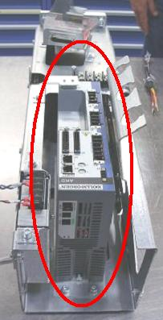
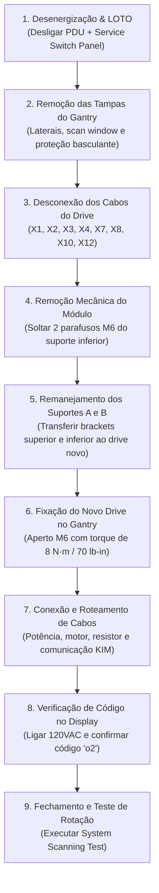
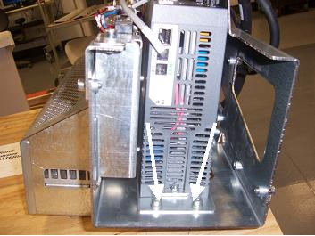
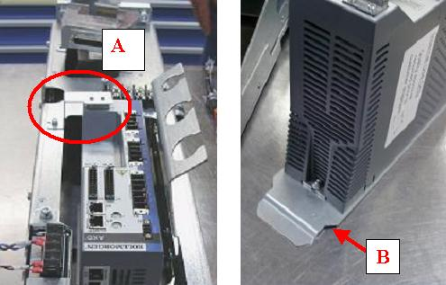
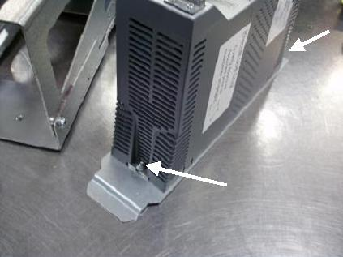
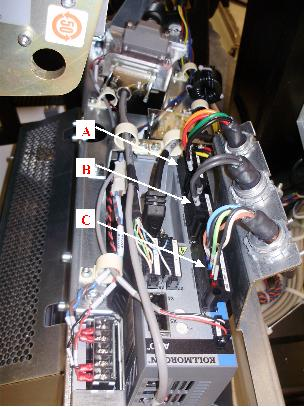
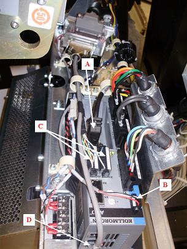
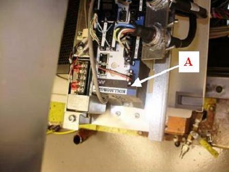

# INSTRUÇÃO DE TRABALHO TÉCNICA

|  | **EMED ELETROMEDICINA LTDA.** **Diagnóstico por Imagem** CNPJ: 03.611.974/0001-08 | **CÓDIGO:** `IT-TOMO-GE-014` **VERSÃO:** `2.4 Homologada` **REVISÃO:** `Rev. 02 (26/10/2026)` **NORMA:** `ANVISA RDC 611` |
|:---:|:---|:---|

---

## IT-TOMO-GE-014: Substituição do Controlador de Rotação do Gantry (Axial Drive Controller)
**Sistema:** Tomógrafo Computadorizado GE BrightSpeed (Lite, Select, 16, Ultra, Plus)  
**Subsistema:** Gantry / Movimentação Mecânica e Rotação Axial / Power Pan  
**Componente:** 2010 Axial Drive Controller (Driver Titan / Danaher Motion)  
**Part Number Oficial GE:** `5344401`  
**Documento Base de Fábrica:** GE Direction 5181178-800 Rev. 16 (Section 1093058)  
**Nível Técnico:** Diagnóstico por Imagem Especializada / Nível 3 (Gantry Drive & Motion Control)  
**Revisão:** 1.0 - Procedimento de Substituição, Cabeamento e Verificação de Display  

---

### 1. OBJETIVO E ESCOPO
Padronizar o procedimento técnico de substituição física, remanejamento de suportes mecânicos, conexão de chicotes de potência/controle e verificação de inicialização do **Controlador de Rotação Axial (*2010 Axial Drive Controller*)** nos tomógrafos da série GE BrightSpeed.

---

### 2. REQUISITOS DE TEMPO, PESSOAL E FERRAMENTAL

* **Equipe Técnica:** 1 Engenheiro de Campo especializado em Tomografia.
* **Tempo de Preparação e Abertura:** ~15 minutos.
* **Tempo de Troca Mecânica e Cabeamento:** ~1 hora a 1h30.
* **Tempo de Teste Funcional:** ~15 a 30 minutos.

#### Ferramental Obrigatório:
| Item | Ferramenta / Equipamento | Função no Procedimento |
| :---: | :--- | :--- |
| **1** | Chaves Allen Métricas de $3\text{ mm}$, $5\text{ mm}$ e $7\text{ mm}$ | Desaperto dos suportes e travas do controlador |
| **2** | Torquímetro de precisão (escala $5$ a $25\text{ N}\cdot\text{m}$) | Aplicação de torque nos parafusos de sustentação M6 |
| **3** | Chave canhão ou soquete hexagonal de $5\text{ mm}$ e $7\text{ mm}$ | Remoção das porcas dos suportes superior e inferior |
| **4** | Multímetro Digital True-RMS CAT III 1000V | Medição de ausência de tensão na régua de alimentação |
| **5** | Pulseira antiestática (ESD) com garra de aterramento | Proteção dos módulos de comunicação digital da placa |
| **6** | Abraçadeiras plásticas (tie-wraps) e alicate de corte | Amarração e roteamento seguro dos chicotes de sinal |

---

### 3. AVISOS CRÍTICOS DE SEGURANÇA E LOTO

> [!CAUTION]
> **PERIGO DE ELETROCUSSÃO - ALTA TENSÃO PRESENTE NO GANTRY:**  
> O compartimento inferior do Gantry (*power pan*) abriga barramentos de alimentação de motores e inversores.  
> Desligue imediatamente o disjuntor principal da tomografia na **PDU** e comute para **OFF** as chaves do *Service Switch Panel* antes de iniciar a intervenção.

> [!WARNING]
> **RISCO DE QUEIMADURA TÉRMICA (RESISTOR DE FRENAGEM):**  
> A superfície metálica do **Resistor de Frenagem Dinâmica (*Brake Resistor*)** localizado junto ao drive atinge temperaturas elevadíssimas durante desacelerações de rotação.  
> **Aguarde o resfriamento completo** do bloco antes de tocar ou manusear chicotes adjacentes.

---

### 4. PROCEDIMENTO PASSO A PASSO

---

#### ETAPA 1: Preparação, Desenergização e Abertura do Gantry
1. Remova a tampa lateral direita do Gantry.
2. No painel de chaves de serviço (**Service Switch Panel**), desligue as 3 chaves:
   - **Axial Drive** $\rightarrow$ **OFF**
   - **HVDC** $\rightarrow$ **OFF**
   - **120VAC** $\rightarrow$ **OFF**
3. Remova as tampas plásticas superior, lateral esquerda, frontal e a janela de varredura (*scan window*).
4. Conecte os plugues terminadores de teste do circuito de intertravamento de emergência (*E-stop terminators*) para permitir acionamento de diagnóstico.
5. Utilizando a chave Allen de $5\text{ mm}$, remova a cobertura de proteção basculante direita (*right side tilting safety cover*) para obter acesso livre ao compartimento do controlador axial.

---

#### ETAPA 2: Remoção do Controlador Axial Antigo
1. Desconecte todos os chicotes de cabos plugados no controlador antigo.
2. Com a chave Allen de $5\text{ mm}$, remova os **2 parafusos** que fixam o suporte inferior do controlador à estrutura do conjunto do drive axial.

3. Retire cuidadosamente o conjunto do controlador para fora do Gantry.
4. **Remoção e Preservação dos Suportes Metálicos:**
   - Remova o **suporte superior em formato de "L" (Suporte A)** com chave canhão/soquete. *Guarde este suporte para reutilização imediata.*
   - Utilizando uma chave Allen de $3\text{ mm}$, solte o **suporte inferior (Suporte B)** da base do controlador defeituoso. *Guarde este suporte para reutilização.*

---

#### ETAPA 3: Montagem dos Suportes no Novo Controlador
1. Retire o novo controlador (*P/N 5344401*) da embalagem antiestática.
2. Fixe o **Suporte Inferior (B)** na base do novo controlador utilizando duas porcas M4 com arruelas de pressão e arruelas lisas:

3. Monte o conjunto do controlador no fundo da caixa da estrutura do drive utilizando **dois parafusos M6**, com arruelas de pressão e lisas:
   - **Aplique torque rigoroso de aperto:**

| Unidade Métrica | Unidade Imperial (lb·in) | Unidade Imperial (lb·ft) | Unidade Gravitacional |
| :---: | :---: | :---: | :---: |
| **$8,0\text{ N}\cdot\text{m}$** | **$70\text{ lb}\cdot\text{in}$** | **$5,8\text{ lb}\cdot\text{ft}$** | **$80,5\text{ kg}\cdot\text{cm}$** |

4. Monte o **Suporte Superior em "L" (A)** no topo do controlador com um parafuso M4, arruela de pressão e lisa.
5. Fixe as duas guias plásticas de cabos no topo do suporte superior utilizando parafusos M4.

---

#### ETAPA 4: Instalação e Roteamento de Cabos (Chicotes de Potência e Sinal)

> [!IMPORTANT]
> A correta identificação dos conectores de potência evita curtos-circuitos e queima dos módulos IGBT do inversor do motor de rotação.

##### A. Conexões de Potência (Conectores X4, X3 e X2):
1. **Porta `X4`:** Conecte o cabo de alimentação de força principal do drive axial proveniente da régua de bornes.
2. **Porta `X3`:** Conecte o cabo do conjunto do resistor de frenagem dinâmica vindo da parte inferior da estrutura.
3. **Porta `X2`:** Conecte o cabo de potência do motor de rotação axial do Gantry.

---

##### B. Conexões de Controle e Comunicação KIM (Conectores X10, X1, X7, X8 e X12):
1. **Porta `X10`:** Conecte o cabo de feedback / encoder do motor de rotação.
2. **Porta `X1`:** Conecte o cabo de comando vindo da placa KIM (*KIM Board*).
3. **Portas `X7` e `X8`:** Conecte os dois conectores retangulares tipo caixa do cabo de comunicação KIM. *(Os pinos possuem chaveta de guia e só encaixam em uma posição).*
4. **Porta `X12`:** Conecte a terceira terminação do cabo de comunicação KIM.

---

#### ETAPA 5: Teste de Inicialização e Confirmação no Display Digital

1. Ligue a chave de serviço **`120VAC`** no *Service Switch Panel*.
2. Observe a janela do display digital de 7 segmentos localizado no topo do controlador axial:
   - O código **`o2`** (letra 'o' minúscula e número '2') **DEVE aparecer fixo no display digital**.

> [!NOTE]
> A exibição do código **`o2`** confirma que a placa de controle do drive foi inicializada com sucesso, o microcontrolador está ativo, a comunicação de rede com a placa KIM foi estabelecida e o sistema está em prontidão (*Standby* normal). Se aparecer qualquer outro código ou ponto piscante, desligue a chave e reconfira os conectores X1, X7, X8 e X12.

3. Desligue a chave **`120VAC`**.
4. Reinstale a proteção basculante (*right side tilting safety cover*) com os parafusos de $5\text{ mm}$.
5. Reinstale as tampas frontal, superior, lateral esquerda e a janela de varredura (*scan window*).
6. No *Service Switch Panel*, religue as 3 chaves: **120VAC**, **Axial Drive** e **HVDC**.
7. Reinstale a tampa lateral direita do Gantry.

---

#### ETAPA 6: Finalização e Teste Dinâmico de Rotação
1. Ligue o sistema e aguarde a inicialização da console de operação.
2. No *Common Service Desktop*, acesse:
   - `[DIAGNOSTICS]` $\rightarrow$ `[FUNCTIONAL CHECKS]` $\rightarrow$ execute o **`[System Scanning Test]`**.
3. Confirme que o Gantry executa rotação suave nas velocidades nominais ($1,0\text{ s}$, $0,8\text{ s}$, $0,5\text{ s}$ por volta) com desaceleração estável e parada sem ruídos ou trepidações.

---

### 5. CHECKLIST DE LIBERAÇÃO CLÍNICA

- [ ] Procedimento LOTO executado com desenergização das 3 chaves do Service Switch.
- [ ] Suportes metálicos A (superior) e B (inferior) transferidos ao novo controlador.
- [ ] Parafusos M6 de sustentação apertados com torque de **$8\text{ N}\cdot\text{m}$ ($70\text{ lb}\cdot\text{in}$)**.
- [ ] Cabos de potência conectados firmemente nas portas X4 (rede), X3 (resistor) e X2 (motor).
- [ ] Cabos de sinal e controle conectados com presilhas nas portas X1, X7, X8, X10 e X12.
- [ ] Código de prontidão **`o2`** confirmado no display de 7 segmentos com chave 120VAC ligada.
- [ ] Proteção basculante e tampas plásticas do Gantry completamente reinstaladas.
- [ ] Teste de varredura e rotação (*System Scanning Test*) executado com sucesso sem alarmes de drive.
