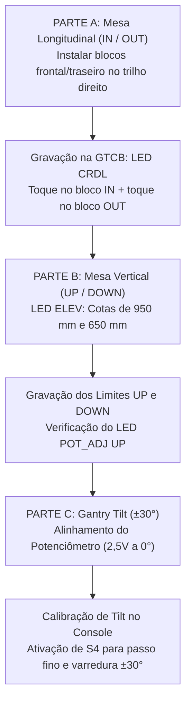
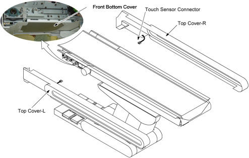
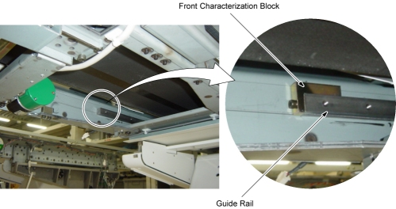
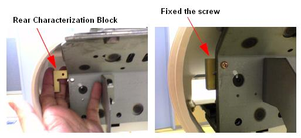
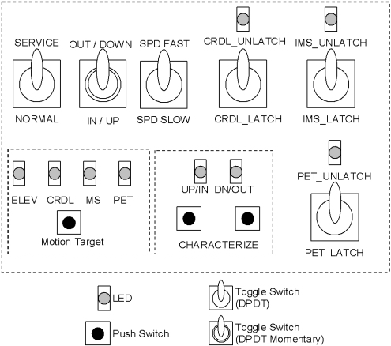
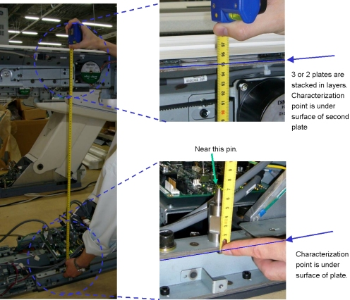
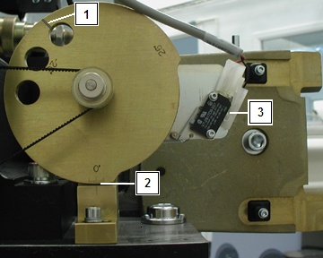
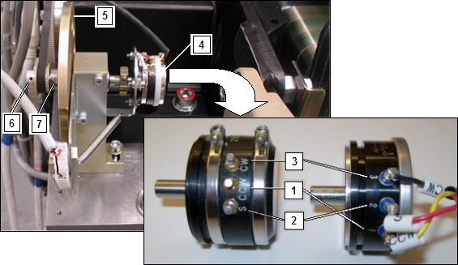

# INSTRUÇÃO DE TRABALHO TÉCNICA - eMED BIOMEDICAL

|  | **EMED ELETROMEDICINA LTDA.** **Engenharia Clínica & Diagnóstico por Imagem** CNPJ: 03.611.974/0001-08 | **CÓDIGO:** `IT-TOMO-GE-015` **VERSÃO:** `2.4 Homologada` **REVISÃO:** `Rev. 02 (26/10/2026)` **NORMA:** `ANVISA RDC 611` |
|:---:|:---|:---|

---

## IT-TOMO-GE-015: Caracterização Completa da Mesa do Paciente (IN / OUT e UP / DOWN) e Calibração do Tilt do Gantry
**Sistema:** Tomógrafo Computadorizado GE BrightSpeed (Lite, Select, 16, Ultra, Plus) & Brivo CT385  
**Subsistemas:** Mesa do Paciente (Patient Table / Cradle) & Inclinação Mecânica do Gantry (Tilt $\pm 30^\circ$)  
**Documentos Base de Fábrica:** GE Direction 5181178-800 Rev. 16 (Seções 918784, 896963 e 126916)  
**Nível Técnico:** Engenharia Clínica Especializada / Nível 2 e 3 (Mecânica e Movimentação)  
**Revisão:** 1.0 - Procedimento Unificado de Calibração de Eixos e Sensores  

---

### 1. OBJETIVO E ESCOPO
Padronizar a rotina de caracterização geométrica e eletrônica dos eixos de movimentação da mesa de exames e da inclinação do Gantry:
* **Eixo Longitudinal (IN / OUT):** Calibração de contagem de passos do encoder e blocos de fim de curso da calha (*Cradle*).
* **Eixo Vertical (UP / DOWN):** Calibração do potenciômetro de elevação e cotas geométricas de precisão ($950\text{ mm}$ e $650\text{ mm}$).
* **Eixo Angular (Tilt do Gantry):** Alinhamento do potenciômetro de inclinação a $0^\circ$ ($2,5\text{V DC}$) e calibração de passo fino (chave `S4`) nos limites de $+30^\circ$ e $-30^\circ$.

---

### 2. FERRAMENTAL E INSUMOS OBRIGATÓRIOS

| Item | Ferramenta / Equipamento | Função no Procedimento |
| :---: | :--- | :--- |
| **1** | Par de Blocos de Caracterização da Calha (*Characterization Blocks*) | Batentes de calibração para início e fim do curso longitudinal |
| **2** | Trena métrica de precisão (com graduação milimétrica) | Medição das cotas verticais de $950 \pm 0,5\text{ mm}$ e $650 \pm 0,5\text{ mm}$ |
| **3** | Multímetro Digital True-RMS calibrado (escala DC) | Medição da tensão de centro do potenciômetro de Tilt ($2,5\text{V DC}$) |
| **4** | Jogo de Chaves Allen Métricas ($2,5\text{ mm}$, $3\text{ mm}$, $4\text{ mm}$, $5\text{ mm}$, $6\text{ mm}$) | Desmontagem de pedais, tampas e soltura de polias |
| **5** | Chaves Phillips (PH1, PH2) e chave de fenda | Abertura de tampas da mesa e painéis do Gantry |

---

### 3. PRECAUÇÕES DE SEGURANÇA E INTERTRAVAMENTO

> [!CAUTION]
> **RISCO DE ESMAGAMENTO E ROTAÇÃO INESPERADA DO GANTRY:**  
> Durante o alinhamento do potenciômetro de Tilt, as chaves **`Axial Drive`** e **`HVDC`** no *Service Switch Panel* DEVEM ser mantidas em **OFF**. O acionamento inadvertido do motor de rotação pode causar ferimentos graves.

> [!WARNING]
> **CHAVE S4 DE PASSO FINO DO TILT:**  
> A microchave **`S4`** no painel de serviço ativa a resolução fina de inclinação para calibração. **NUNCA** deixe a chave S4 em ON após o término do serviço, pois os botões do painel do operador perderão a velocidade padrão de inclinação clínica.

---

### 4. PROCEDIMENTO PASSO A PASSO

---

### PARTE A: CARACTERIZAÇÃO DO MOVIMENTO LONGITUDINAL DA CALHA (CRADLE IN / OUT)

1. Ajuste a altura da mesa para uma posição intermediária que permita a inserção livre da calha no túnel do Gantry (*bore*).
2. **Remoção de Tampas de Acesso:**
   - Remova a tampa superior direita da mesa (2 parafusos).
   - Remova a tampa frontal inferior da mesa (4 parafusos).

3. **Instalação dos Blocos de Caracterização nos Trilhos Guia:**
   - Instale o **Bloco de Caracterização Dianteiro** na extremidade frontal do trilho guia direito (*front end of right guide rail*).
   

   - Instale o **Bloco de Caracterização Traseiro** na extremidade posterior do trilho guia direito (*rear end of right guide rail*).

4. **Operação na Placa GTCB (Gantry / Table Control Board):**
   - Na placa de controle interna da mesa, comute a chave seletora de serviço **`MODE_SEL`** para a posição **`SERVICE`**.
   - Verifique se o LED **`CRDL`** está aceso na GTCB. Caso contrário, pressione o botão **`Motion Target`** até que o LED **`CRDL`** acenda.

5. **Execução do Ciclo de Caracterização:**
   - Pressione os **dois botões `Characterize` simultaneamente** para iniciar o modo de calibração.
   - O LED **`UP/IN`** acenderá.
   - Utilizando as chaves manuais de serviço (chaves de avanço *Fast* e *Slow*), mova a calha para dentro (**IN**) até que a borda da calha apenas toque suavemente no bloco dianteiro.
   - Pressione os **dois botões `Characterize` simultaneamente**.
   - O LED **`DOWN/OUT`** acenderá.
   - Utilizando as chaves de serviço, mova a calha para fora (**OUT**) até que ela toque suavemente no bloco traseiro.
   - Pressione os **dois botões `Characterize` simultaneamente**.
6. **Gravação e Confirmação:**
   - Aguarde de 5 a 10 segundos: ambos os LEDs (`UP/IN` e `DOWN/OUT`) apagarão, indicando que os dados foram gravados com sucesso na memória flash.
   - *(Se ambos os LEDs piscarem repetidamente, a caracterização falhou por toque incorreto; repita o ciclo).*
7. **Validação no Log do Sistema (Syslog):**
   - Acesse o syslog da console e confirme a mensagem de conclusão com o parâmetro:
     $$\text{ABS }\mu\text{m per count} \approx 18,3\ \mu\text{m/count}$$
8. Remova os dois blocos de caracterização dos trilhos e retorne a chave **`MODE_SEL`** para a posição **`NORMAL`**.

---

### PARTE B: CARACTERIZAÇÃO DO MOVIMENTO VERTICAL DA MESA (ELEVATION UP / DOWN)

1. Mova a calha para a posição limite externa (**OUT limit**).
2. No painel de chaves do Gantry (*Service Switch Panel*), desligue as chaves **`HVDC`**, **`Axial Drive`** e **`120VAC`**.
3. Remova a tampa inferior traseira da mesa (2 parafusos) e desmonte os pedais de comando de pé (4 parafusos Allen).
4. Religue a alimentação de **`120VAC`**.
5. Na placa GTCB da mesa, coloque a chave **`MODE_SEL`** em **`SERVICE`**.
6. Pressione o botão **`Motion Target`** até que o LED **`ELEV`** acenda.
7. Mantenha pressionada a chave de serviço de elevação para **IN/UP** até que a mesa atinja o **limite mecânico superior (UP-limit)**.
8. **Verificação do Potenciômetro de Altura:**
   - Confirme se o LED verde **`POT_ADJ UP`** está **ACESO**.
   - *(Se o LED estiver apagado, o potenciômetro de elevação necessita de pré-ajuste mecânico girando sua engrenagem até o acendimento do LED).*
9. Pressione os **dois botões `Characterize` simultaneamente**:
   - O LED **`UP/IN`** acenderá.
10. **Ajuste do Ponto de Caracterização 1 ($950\text{ mm}$):**
    - Com a chave de serviço de descida, ajuste a altura da mesa de forma que a distância medida com trena entre os pontos de referência geométricos seja rigorosamente de:
      $$\text{Distância Ponto 1} = 950,0 \pm 0,5\text{ mm}$$

11. Pressione os **dois botões `Characterize` simultaneamente**:
    - O LED **`DOWN/OUT`** acenderá.
12. **Ajuste do Ponto de Caracterização 2 ($650\text{ mm}$):**
    - Desça a mesa até que a distância entre os pontos de referência seja de:
      $$\text{Distância Ponto 2} = 650,0 \pm 0,5\text{ mm}$$
13. Pressione os **dois botões `Characterize` simultaneamente**:
    - Ambos os LEDs **`UP/IN`** e **`DOWN/OUT`** acenderão juntos.
14. **Ajuste do Limite Mecânico Inferior:**
    - Utilizando a chave de serviço, desça a mesa até o seu **limite mecânico inferior total (mechanical down-limit)**.
15. Pressione os **dois botões `Characterize` simultaneamente**.
16. Aguarde de 5 a 10 segundos: os LEDs apagarão, confirmando a gravação dos dados na memória flash da placa.
17. Comute a chave **`MODE_SEL`** para **`NORMAL`** e reinstale as tampas e pedais de pé.

---

### PARTE C: ALINHAMENTO DO POTENCIÔMETRO E CALIBRAÇÃO DO TILT DO GANTRY ($\pm 30^\circ$)

#### C.1 Alinhamento do Ponto Central do Potenciômetro ($0^\circ = 2,50\text{V DC}$)
1. Remova as tampas plásticas laterais direita e esquerda do Gantry.
2. Desligue as chaves **`Axial Drive`** e **`HVDC`** no painel de serviço, mantendo **`120VAC` em ON**.
3. Verifique visualmente a marcação de zero grau no came de inclinação (*tilt cam*): o Gantry deve estar alinhado no marco zero com o microswitch de limite desacionado:

4. **Medição de Tensão de Referência com Multímetro:**
   - Com o Gantry energizado em 120VAC, meça a tensão contínua total de alimentação do potenciômetro entre os terminais **`CCW` (+)** e **`CW` (-)**: o valor deve ser de aproximadamente $5,0\text{V DC}$.
   - Calcule a tensão de centro exata:
     $$V_{\text{centro}} = \frac{V_{\text{total}}}{2} \approx 2,50\text{V DC}$$
5. Meça a tensão entre o terminal do cursor **`S` (+)** e **`CW` (-)** (ou pino 2 no potenciômetro Tipo 2):

6. **Ajuste Físico (se a leitura diferir de $2,50 \pm 0,20\text{V}$):**
   - Afrouxe o parafuso Allen sem cabeça da polia dentada de 32 dentes do potenciômetro.
   - Gire suavemente o eixo do potenciômetro até que a tensão lida no multímetro seja de exatamente $V_{\text{centro}} \pm 0,2\text{V}$.
   - Aperte firmemente o parafuso Allen da polia mantendo a correia sincronizadora no lugar.
   - O alinhamento elétrico do marco de $0^\circ$ está concluído.

---

#### C.2 Caracterização Eletrônica do Tilt no Service Desktop
1. No console do tomógrafo, abra o **Common Service Desktop**.
2. Navegue até:
   - `[CALIBRATION]` $\rightarrow$ `[MECHANICAL CALIBRATION]`.
3. Clique no botão **`[Characterization Tilt]`**.
4. **Ativação da Resolução de Passo Fino:**
   > [!IMPORTANT]
   > No painel de serviço do Gantry, comute a chave **`S4 para ON`**. Isto habilita a movimentação com micro-resolução angular necessária para calibração precisa (o botão comum move apenas de $0,5^\circ$ em $0,5^\circ$).
5. Siga as instruções automáticas na tela:
   - O sistema solicitará a inclinação até o limite positivo máximo ($+30,0^\circ$).
   - O sistema solicitará o retorno para o centro ($0,0^\circ$).
   - O sistema solicitará a inclinação até o limite negativo máximo ($-30,0^\circ$).
6. Ao término, a tela confirmará o status verde de calibração concluída (*Tilt Characterization PASSED*).
7. **RETORNE OBRIGATORIAMENTE A CHAVE `S4` PARA A POSIÇÃO `OFF`**.
8. Religue as chaves **`Axial Drive`** e **`HVDC`** e reinstale as tampas do Gantry.

---

### 5. CHECKLIST DE LIBERAÇÃO CLÍNICA

- [ ] Blocos de caracterização instalados nos trilhos e calha calibrada em IN e OUT sem atritos.
- [ ] Parâmetro de contagem da calha validado no syslog ($\approx 18,3\ \mu\text{m/count}$).
- [ ] Chave `MODE_SEL` da mesa retornada à posição **NORMAL**.
- [ ] Elevação da mesa calibrada nos pontos de precisão de $950\text{ mm}$, $650\text{ mm}$ e limite inferior.
- [ ] LED verde `POT_ADJ UP` comprovado aceso no limite superior.
- [ ] Potenciômetro de Tilt medindo $2,50 \pm 0,2\text{V DC}$ no marco de zero grau mecânico.
- [ ] Chave de serviço `S4` utilizada para calibração de passo fino e **desligada (OFF)** ao final.
- [ ] Teste de inclinação executado nos limites de $+30^\circ$ e $-30^\circ$ pelo painel do operador.
- [ ] Todas as tampas da mesa e do Gantry devidamente parafusadas.
