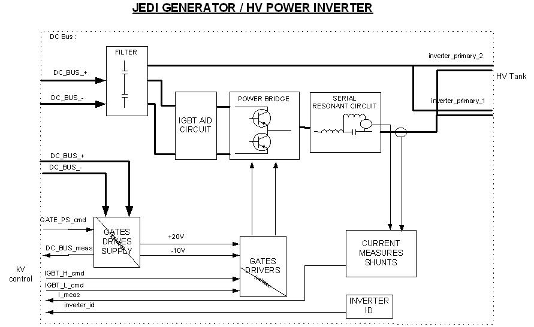
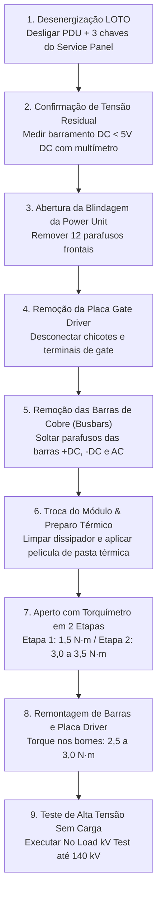
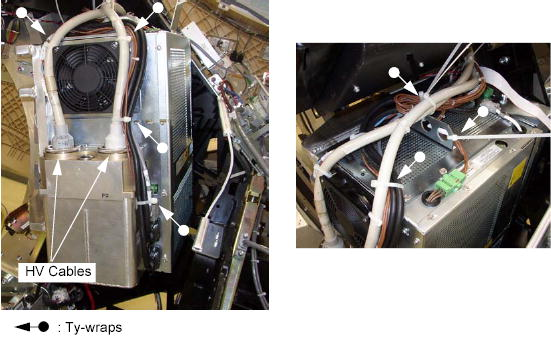
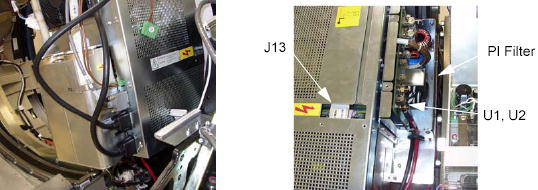
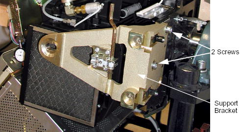

# INSTRUÇÃO DE TRABALHO TÉCNICA - eMED BIOMEDICAL
## IT-TOMO-GE-016: Diagnóstico e Substituição dos Módulos de Potência IGBT no Inversor de Alta Tensão (JEDI Generator)
**Sistema:** Tomógrafo Computadorizado GE BrightSpeed (Lite, Select, 16, Ultra, Plus) & Brivo CT385  
**Subsistema:** Power Unit / Gantry High Voltage Generation / Inversor Ressonante JEDI  
**Componentes:** Módulos de Potência IGBT ($1200\text{V} / 400\text{A}$), Placa de Disparo de Gate (*Gate Driver Board*), Barramentos de Cobre (*Busbars*)  
**Documentos Base de Fábrica:** GE Direction 5181178-800 Rev. 16 (Seções 1012794, 1074627 e 254380)  
**Nível Técnico:** Engenharia Clínica Especializada / Nível 3 (Eletrônica de Potência & Alta Tensão)  
**Revisão:** 1.0 - Procedimento de Teste em Bancada, Substituição Mecânica, Pasta Térmica e No-Load Test  

---

### 1. OBJETIVO E ESCOPO
Padronizar a rotina de diagnóstico, medição com multímetro, desmontagem mecânica, aplicação de pasta térmica, torqueamento controlado e testes de revalidação sem carga (*No Load kV Test*) para a substituição dos **Módulos de Transistor Bipolar de Gate Isolado (IGBTs)** da unidade de potência (*Power Unit*) do gerador JEDI em tomógrafos GE BrightSpeed.



---

### 2. PRINCÍPIO DE OPERAÇÃO DOS IGBTS NO GERADOR JEDI

O inversor de alta tensão do gerador JEDI é um **inversor hipo-ressonante (*hypo-resonant inverter*)** que converte a tensão contínua do barramento ($750\text{V DC}$) em corrente alternada de alta frequência para excitar os enrolamentos primários do Tanque de Alta Tensão:
* **Topologia Half-Bridge (BrightSpeed Lite / JEDI 60DC):** Utiliza **2 módulos IGBT** (1 por polaridade: semiciclo positivo e semiciclo negativo).
* **Topologia Full-Bridge / Paralelo (BrightSpeed 16 / Select / Ultra):** Utiliza **4 módulos IGBT** (2 IGBTs em paralelo por polaridade para condução de até $400\text{A}$ a $800\text{A}$ de pico).
* **Controle por Modulação de Frequência:**
  * **Potência Mínima ($0\text{ mA}$):** Opera na frequência de ressonância paralela ($\approx 20\text{ kHz}$).
  * **Potência Máxima ($350\text{ mA} - 500\text{ mA}$):** Opera próximo à frequência de ressonância série ($45\text{ kHz} - 70\text{ kHz}$).
* **Comando de Gate (Gate Driver):**
  * Tensão de Condução Saturada ($ON$): **$+20\text{V DC}$** (reduzindo a resistência interna $V_{CE(sat)}$).
  * Tensão de Bloqueio Reverso ($OFF$): **$-10\text{V DC}$** (assegura imunidade contra disparos acidentais provocados por variações bruscas de $dV/dt$).
  * Isolamento Galvânico: Transformadores de pulso (*pulse transformers*) entre a KV Control Board e a Gate Command Board.

---

### 3. FERRAMENTAL E INSUMOS OBRIGATÓRIOS

| Item | Ferramenta / Insumo | Especificação e Função |
| :---: | :--- | :--- |
| **1** | Multímetro Digital True-RMS CAT III 1000V | Escala de teste de diodo ($V$) e alta resistência ($\text{M}\Omega$) |
| **2** | Torquímetro de Precisão (faixa de $1,0$ a $6,0\text{ N}\cdot\text{m}$) | **Obrigatório:** Aperto controlado dos parafusos do dissipador e bornes |
| **3** | Pasta Térmica de Alta Condutividade ($> 3,5\text{ W/m}\cdot\text{K}$) | Silicone neutro/óxido de zinco de alta performance |
| **4** | Espátula plástica flexível | Aplicação de filme fino e uniforme ($\approx 50-100\ \mu\text{m}$) de pasta |
| **5** | Álcool Isopropílico 99,8% e panos de microfibra limpos | Limpeza total de resíduos térmicos no dissipador de alumínio |
| **6** | Chaves Allen Métricas ($3\text{ mm}$, $4\text{ mm}$, $5\text{ mm}$) | Soltura das barras de barramento e placas de comando |
| **7** | Chaves de Caixa / Soquete Hexagonal M5 e M6 | Fixação dos terminais Coletor, Emissor e Barramentos DC |
| **8** | Pulseira e Manta Antiestática (ESD) | Proteção dos gates altamente sensíveis dos IGBTs |
| **9** | Kit de Bloqueio LOTO | Desenergização do disjuntor da PDU e chaves do Gantry |

---

### 4. AVISOS CRÍTICOS DE SEGURANÇA (LOTO)

> [!CAUTION]
> **PERIGO DE MORTE - ALTA TENSÃO E ENERGIA RESIDUAL DE CAPACITORES:**  
> O barramento DC da Power Unit permanece carregado com até **$750\text{V DC}$** mesmo após o desligamento da chave da máquina!  
> **NUNCA** toque nos terminais dos IGBTs sem antes:
> 1. Desligar o disjuntor geral da tomografia na **PDU** com trava LOTO;
> 2. Desligar as 3 chaves do *Service Switch Panel* (`Axial Drive`, `HVDC`, `120VAC`);
> 3. Medir com multímetro nos bornes $+DC$ e $-DC$ e comprovar tensão residual **inferior a $5\text{V DC}$**.

---

### 5. DIAGNÓSTICO E TESTE DE BANCADA DOS IGBTS COM MULTÍMETRO

Antes de condenar ou montar um novo módulo IGBT, execute o teste com multímetro em bancada:

```
Terminais Típicos do Módulo IGBT:
       +---------------+
       |   C2E1 (AC)   |  <-- Saída Alternada para o Tanque HV
       +---------------+
   +-------+       +-------+
   | C1 (+) |       | E2 (-) | <-- Barramento DC (+750V / 0V)
   +-------+       +-------+
    [G1 E1]         [G2 E2]   <-- Terminais de Gate e Emissor Auxiliar
```

#### Teste 1: Junção Coletor-Emissor e Diodo Antiparalelo (Escala de Diodo)
1. Coloque o multímetro na **Escala de Diodo**.
2. **Polarização Direta do Diodo Interno:**
   - Ponta **Vermelha (+)** no Emissor ($E$) e Ponta **Preta (-)** no Coletor ($C$):
   - **Resultado Normal:** Leitura entre **$0,350\text{V}$ e $0,480\text{V}$** (queda direta de tensão do diodo de retorno rápido).
3. **Polarização Reversa do Módulo:**
   - Ponta **Vermelha (+)** no Coletor ($C$) e Ponta **Preta (-)** no Emissor ($E$):
   - **Resultado Normal:** Circuito aberto (**`OL`** ou infinito).
   - ⚠️ **Defeito:** Se o multímetro apitar (bip contínuo) ou acusar $< 0,050\text{V}$, o **IGBT está em curto-circuito total**.

#### Teste 2: Isolação de Gate (Escala de Alta Resistência - $\text{M}\Omega$)
1. Coloque o multímetro na escala de maior resistência ($\text{M}\Omega$ ou $200\text{ M}\Omega$).
2. Meça entre **Gate ($G$)** e **Emissor ($E$)**, e entre **Gate ($G$)** e **Coletor ($C$)**:
   - **Resultado Normal:** Circuito aberto total (**`OL`** / resistência infinita).
   - ⚠️ **Defeito:** Qualquer leitura abaixo de $10\text{ M}\Omega$ indica que a camada isolante de óxido de silício ($SiO_2$) do gate foi perfurada por pico de sobretensão ($dV/dt$), exigindo descarte imediato do módulo.

---

### 6. PROCEDIMENTO PASSO A PASSO DE SUBSTITUIÇÃO



---

#### ETAPA 1: Desenergização, LOTO e Abertura da Power Unit
1. Abaixe a mesa de exames até a elevação mínima.
2. Desligue o disjuntor principal da tomografia na **PDU** e aplique trava e etiqueta LOTO.
3. No *Service Switch Panel* do Gantry, comute as **3 chaves para OFF**: `Axial Drive`, `HVDC` e `120VAC`.
4. Remova as tampas plásticas superior e frontal do Gantry.
5. Remova os **12 parafusos sextavados** da tampa de blindagem da Power Unit e desencaixe a tampa frontal.



6. Com o multímetro em escala DC $1000\text{V}$, meça a tensão entre as barras de cobre $+DC$ e $-DC$. **Certifique-se de que a leitura seja $< 5\text{V DC}$** antes de prosseguir.

---

#### ETAPA 2: Remoção da Placa de Disparo de Gate (Gate Driver Board) e Barramentos
1. Conecte a pulseira antiestática no chassi metálico do Gantry.
2. Identifique a placa de disparo de gate montada diretamente sobre ou adjacente aos módulos IGBT:
   - Desconecte o cabo de sinal de comando vindo da KV Control Board.
   - Solte os parafusos dos terminais auxiliares de Gate e Emissor ($G1, E1, G2, E2$).
   - Remova a placa de disparo e inspecione visualmente se há resistores de gate carbonizados.
3. Desparafuse os parafusos M5/M6 das barras condutoras de cobre (*busbars*):
   - Barra positiva $+DC$ (vermelha)
   - Barra negativa $-DC$ (preta/azul)
   - Barra de saída de corrente alternada $AC$ para o circuito ressonante LC do tanque HV.



4. Afaste com cuidado as barras condutoras para desobstruir os módulos IGBT.

---

#### ETAPA 3: Remoção do Módulo IGBT Defeituoso e Preparo do Dissipador
1. Desparafuse os parafusos de fixação que prendem a carcaça do módulo IGBT ao dissipador de calor de alumínio (*heatsink*).
2. Destaque o módulo antigo do dissipador.
3. **Limpeza Técnica do Dissipador:**
   - Com pano de microfibra embebido em álcool isopropílico $99,8\%$, remova **100% da pasta térmica antiga ressecada** da superfície de alumínio.
   - Verifique se a superfície do dissipador está perfeitamente plana, sem rebarbas, arranhões profundos ou partículas de sujeira.

---

#### ETAPA 4: Aplicação da Pasta Térmica e Instalação do Novo Módulo IGBT

> [!IMPORTANT]
> A pasta térmica atua preenchendo as microscópicas bolsas de ar entre o módulo e o dissipador. **Nunca aplique em excesso!** Camada grossa cria resistência térmica e causa queima por sobreaquecimento (*thermal breakdown*). Camada insuficiente causa queima por pontos quentes (*hot spots*).

1. Retire o novo módulo IGBT da embalagem antiestática.
2. Com a espátula plástica, aplique uma película extremamente fina, lisa e homogênea de pasta térmica (espessura recomendada entre $50\ \mu\text{m}$ e $100\ \mu\text{m}$) sobre a placa de base de cobre niquelado do módulo.
3. Posicione o módulo sobre o dissipador de calor alinhando rigorosamente as furações roscadas.
4. Insira os parafusos de fixação com suas respectivas arruelas de pressão e arruelas lisas.
5. **Aperto Controlado com Torquímetro em Duas Etapas:**

```
Ordem de Aperto Cruzado dos Parafusos da Base:
     (1) -------- (4)
      |            |
     (3) -------- (2)
```

| Etapa de Fixação | Torque Recomendado | Procedimento de Aperto |
| :---: | :---: | :--- |
| **Etapa 1 (Pré-torque)** | **$1,5\text{ N}\cdot\text{m}$ ($13\text{ lb}\cdot\text{in}$)** | Aperto cruzado uniforme em todos os parafusos para espalhar a pasta |
| **Etapa 2 (Torque Final)** | **$3,0$ a $3,5\text{ N}\cdot\text{m}$ ($26$ a $31\text{ lb}\cdot\text{in}$)** | Aperto cruzado final conferindo a fixação firme da base cerâmica |

---

#### ETAPA 5: Remontagem dos Barramentos de Cobre e Placa de Gate
1. Recoloque as barras de cobre (*busbars*) de alimentação e saída alternada nos terminais principais dos IGBTs.
2. Aperte os parafusos dos terminais elétricos principais com torquímetro:
   - **Torque dos Bornes dos IGBTs (M5 / M6):** **$2,5$ a $3,0\text{ N}\cdot\text{m}$ ($22$ a $26\text{ lb}\cdot\text{in}$)**.
3. Reinstale a placa de disparo de gate (*Gate Command Board*):
   - Conecte os terminais auxiliares $G$ e $E$ com torque suave manual ($\approx 0,8\text{ N}\cdot\text{m}$).
   - Reconecte os chicotes de comando e realimentação.



4. Reinstale a tampa frontal de blindagem da Power Unit com os **12 parafusos sextavados**.
5. Religue as 3 chaves do *Service Switch Panel*: **120VAC**, **Axial Drive** e **HVDC**.
6. Remova o bloqueio LOTO da PDU e religue o disjuntor geral.

---

#### ETAPA 6: Protocolo Obrigatório de Revalidação de Alta Tensão (No Load Test)

> [!WARNING]
> Nunca dispare o tomógrafo em carga clínica máxima logo após trocar módulos IGBT. É mandatório executar o teste de alta tensão sem carga (*No Load kV Test*) para verificar a comutação sob tensão plena sem corrente de tubo.

1. Ligue o console do tomógrafo e acesse o **Common Service Desktop**.
2. Navegue até: `[DIAGNOSTICS]` $\rightarrow$ `[X-RAY GENERATION]` $\rightarrow$ `[Generator Tool - JEDI]`.
3. Selecione a ferramenta **`[kV Diagnostics]`** / **`[No Load kV Test]`**:
   - Este teste desativa o filamento do tubo ($0\text{ mA}$) e aplica pulsos curtos de alta tensão aos IGBTs.
4. Execute a rampa progressiva de disparos:
   * **Passo 1:** $60\text{ kV}$ (sem carga) $\rightarrow$ Verificar simetria de chaveamento no oscilograma.
   * **Passo 2:** $80\text{ kV}$ (sem carga) $\rightarrow$ Confirmar ausência de falha de sobrecorrente de inversor (*IOC*).
   * **Passo 3:** $100\text{ kV}$ (sem carga) $\rightarrow$ Checar estabilidade dos inversores positivo e negativo.
   * **Passo 4:** $120\text{ kV}$ (sem carga) $\rightarrow$ Tensão nominal de escaneamento.
   * **Passo 5:** $140\text{ kV}$ (sem carga) $\rightarrow$ Tensão máxima do sistema.
5. Se todos os passos finalizarem sem erros de arco ou disparo de proteção, o chaveamento dos novos IGBTs está validado.
6. **Pipeline Final de Calibração com Emissão de Raio-X:**
   * Executar **`[Filament Cal]`** (Calibração de corrente de filamento fino e grosso).
   * Executar **`[HHS Scans]`** (Varreduras em alta rotação sob carga contínua).
   * Executar teste de calibração no **Fantom de Água de QA** ($120\text{ kV} / 200\text{ mA}$, tolerância de $0 \pm 4\text{ HU}$, desvio padrão do ruído $< 3,5\text{ HU}$).

---

### 7. CHECKLIST DE LIBERAÇÃO CLÍNICA

- [ ] Procedimento LOTO executado com medição de barramento DC confirmada em $< 5\text{V DC}$.
- [ ] Teste em bancada com multímetro realizado nos novos IGBTs antes da montagem (sem curtos C-E e gates íntegros).
- [ ] Superfície do dissipador de alumínio desengraxada e limpa com álcool isopropílico $99,8\%$.
- [ ] Película ultrafina de pasta térmica aplicada homogeneamente na base metálica dos módulos.
- [ ] Parafusos de fixação do módulo apertados em duas etapas cruzadas com torquímetro ($1,5\text{ N}\cdot\text{m} \rightarrow 3,2\text{ N}\cdot\text{m}$).
- [ ] Barramentos de cobre $+DC$, $-DC$ e $AC$ reapertados com torque de $2,5 - 3,0\text{ N}\cdot\text{m}$.
- [ ] Tampa frontal da Power Unit fechada com os 12 parafusos sextavados de blindagem.
- [ ] Teste progressivo sem carga (*No Load kV Test*) executado de $60\text{ kV}$ até $140\text{ kV}$ sem erros de inversor.
- [ ] Calibração de filamentos (Small e Large) e varreduras HHS executadas com sucesso.
- [ ] Exame de QA com fantom de água aprovado dentro dos padrões ($0 \pm 4\text{ HU}$).
- [ ] Equipamento lacrado, tampas instaladas e sistema liberado para exames com pacientes.
