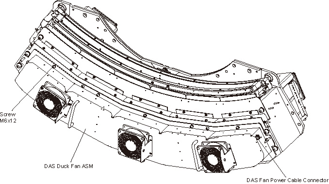
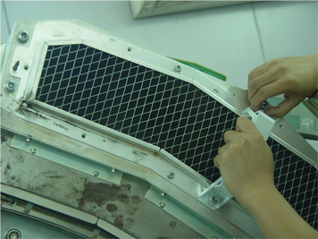
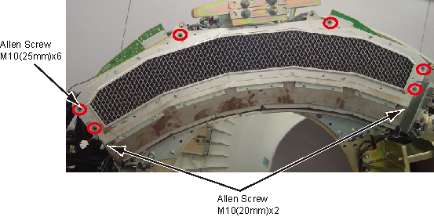
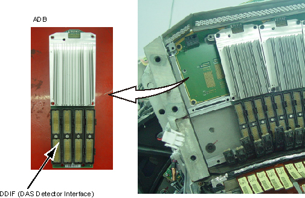
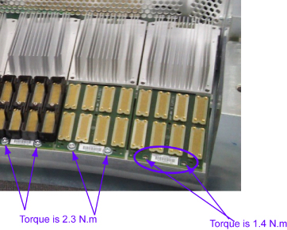
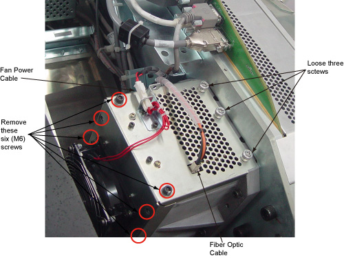
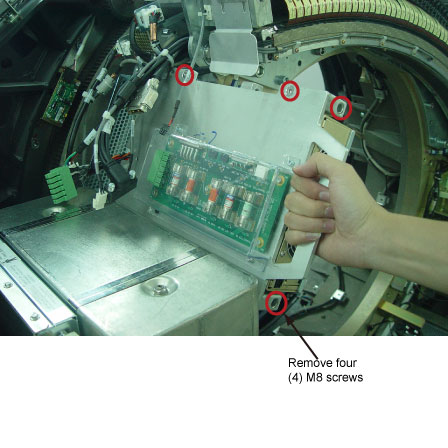

# IT-GE-CT-018: Substituição, Conexões e Calibração do Detector Pancake DAS (PDAS) - GE BrightSpeed / Brivo CT

|  | **EMED ELETROMEDICINA LTDA.** **Engenharia Clínica & Diagnóstico por Imagem** CNPJ: 03.611.974/0001-08 | **CÓDIGO:** `IT-TOMO-GE-018` **VERSÃO:** `2.4 Homologada` **REVISÃO:** `Rev. 02 (26/10/2026)` **NORMA:** `ANVISA RDC 611` |
|:---:|:---|:---|

---

## 1. OBJETIVO E ESCOPO
Esta Instrução de Trabalho (IT) estabelece o protocolo técnico rigoroso para o diagnóstico, desmontagem com proteção eletrostática (ESD), substituição mecânica/eletrônica e rotina de calibração térmica e de ganho dos componentes do subsistema **Pancake DAS (PDAS)** e módulos conversores de canais (ADB / DCB / Fonte) nos tomógrafos **GE BrightSpeed (4, 8 e 16 canais)** e **GE Brivo CT385**.

> [!CAUTION]
> **RISCO CRÍTICO DE DANOS ELETROSTÁTICOS (ESD) E DEFORMACÃO DE CABOS FLEX**:
> Os detectores cintiladores e as placas de conversão analógica-digital (ADB) são componentes de ultra-alta precisão sensíveis a descargas eletrostáticas mínimas (< 100V). É **obrigatório** o uso de manta condutiva, pulseira ESD com cabo de aterramento conectado ao chassi metálico da gantry e o uso exclusivo da **Ferramenta de Extração de Flex** (P/N 2344539). **NUNCA puxe cabos flexíveis com os dedos ou pinças comuns**.

---

## 2. ESPECIFICAÇÕES TÉCNICAS E CÓDIGOS DE PEÇAS (FRU)

| Componente do PDAS | Código Part Number (P/N) | Função do Subsistema | Torque Recomendado |
| :--- | :--- | :--- | :--- |
| **Placa de Controle PDAS (DCB)** | P/N 5317077 | Sincronismo mestre, multiplexação e clock do detector | $2,3\text{ N}\cdot\text{m}$ (M4) |
| **Módulos Conversores ADB (Placas A/D)** | P/N 2344539 (Kit) | Digitalização dos sinais fotomultiplicadores dos canais | $2,3\text{ N}\cdot\text{m}$ (M4) |
| **Fonte de Alimentação PDAS (PSU)** | P/N 5488054 | Barramentos regulados de baixa tensão analógica e digital | $19,2\text{ N}\cdot\text{m}$ (M8) |
| **Ferramenta de Extração de Cabos Flex** | P/N 2344539-EXT | Destravamento das travas ZIF e extração linear segura | N/A |
| **Parafusos da Tampa do Chassi Filtro** | M10 × 8 Allen | Vedação mecânica e duto de fluxo de ar laminar | $38,4\text{ N}\cdot\text{m}$ |
| **Parafusos da Tampa IFB / Enclosure** | M6 Allen / M4 Philips | Blindagem eletromagnética (EMI) da caixa do PDAS | $7,9\text{ N}\cdot\text{m}$ (M6) / $2,3\text{ N}\cdot\text{m}$ (M4) |

---

## 3. FERRAMENTAL E EQUIPAMENTOS OBRIGATÓRIOS
1. **Kit de Proteção Antiestática de Campo (Field ESD Kit)**: manta condutiva, pulseira de punho com resistor limitador de $1\text{ M}\Omega$ e garra jacaré.
2. **Chaves Hexagonais (Allen)**: tamanhos 3 mm, 4 mm, 5 mm, 6 mm e 8 mm.
3. **Chave Torquímetro Calibrada**: escala de $1,0\text{ N}\cdot\text{m}$ a $45,0\text{ N}\cdot\text{m}$.
4. **Ferramenta Especial Extratora de Conectores Flexíveis DDIF** (P/N 2344539).
5. **Alças de Içamento/Manuseio do Módulo de Ar (Air Filter Cover Handles)**.
6. **Phantom Homogêneo de Qualidade de Imagem (GE 20 cm / 48 cm Water/CATPHAN)**.

---

## 4. PROCEDIMENTO DE DESMONTAGEM E ACESSO AO PDAS

### 4.1 Posicionamento Seguro e Desenergização (LOTO)
1. Pela console do operador ou botoeira de gantry, abaixe a mesa do paciente para a altura mínima de repouso ($650\text{ mm}$).
2. Desloque o berço longitudinalmente para fora da gantry (posição HOME ou retirada completa).
3. Gire manualmente a gantry e posicione o subsistema Pancake DAS na posição de trabalho:
   - Para acesso aos módulos ADB: posição **2 horas**.
   - Para acesso à Fonte de Alimentação ou Backplane: posição **12 horas**.
4. Engate o **Pino Mecânico de Travamento da Rotação (Gantry Rotational Lock)**.
5. Desligue as 3 chaves seccionadoras de serviço da gantry:
   - `Axial Drive Enable` -> **OFF**
   - `HVDC Enable` -> **OFF**
   - `120 VAC Service Switch` -> **OFF**
6. Aplique etiqueta e cadeado de segurança (Lockout / Tagout) no disjuntor principal da PDU de parede.

### 4.2 Desmontagem das Carenagens e Dutos de Refrigeração
1. Remova as carenagens frontais, laterais e superior da gantry.
2. Desconecte o cabo de alimentação do conjunto de ventiladores do duto (`Duct Fan ASM`).
3. Solte os parafusos de fixação e remova a tampa do duto de ventilação frontal:

4. Instale as alças de suporte nos pontos roscados da carcaça do filtro de ar para garantir empunhadura firme:

5. Solte os 8 parafusos M10 Allen que fixam o conjunto de filtragem de ar e retire cuidadosamente o bloco:

---

## 5. SUBSTITUIÇÃO DOS MÓDULOS CONVERSORES ADB

### 5.1 Desconexão dos Cabos Flexíveis com a Ferramenta Especial
> [!WARNING]
> Nunca dobre, torça ou puxe os cabos flexíveis diretamente com as mãos. Qualquer microrachadura nas trilhas de cobre causará artefatos irreversíveis de anéis (ring artifacts) na imagem tomográfica.

1. Conecte a garra jacaré da pulseira ESD na carcaça de aterramento do detector.
2. Posicione a ponteira da **Ferramenta de Extração de Flex** sob a trava plástica do conector DDIF.
3. Acione o movimento linear para trás, extraindo suavemente a fita condutora de cada placa ADB:

4. Desaperte os 6 parafusos M4 de retenção da placa ADB defeituosa na placa-mãe (backplane).
5. Deslize a placa para fora dos pinos-guia e acondicione-a imediatamente em saco antiestático metalizado (ESD Shielding Bag).

### 5.2 Instalação e Torqueamento da Nova Placa ADB
1. Retire a nova placa ADB da embalagem de proteção antiestática.
2. Alinhe os orifícios guia da placa com os pinos de centralização na backplane.
3. Pressione suavemente até o acoplamento uniforme dos conectores multi-pino traseiros.
4. Aperte os parafusos de fixação seguindo a sequência cruzada com torquímetro calibrado:

$$\text{Torque dos Parafusos M4 (ADB)} = 2,3\text{ N}\cdot\text{m} \pm 0,2\text{ N}\cdot\text{m}$$

5. Reconecte cuidadosamente os cabos flexíveis DDIF, pressionando as abas de travamento até o clique perceptível.

---

## 6. ACESSO À PLACA DCB E FONTE DE ALIMENTAÇÃO DO PDAS

### 6.1 Substituição da Placa de Controle DCB (P/N 5317077)
1. Para substituição da placa DCB, solte os parafusos M6 Allen da tampa da caixa de interface (IFB Cover):

2. Desconecte os cabos de comunicação óptica e barramentos seriais.
3. Remova a placa DCB e instale a nova unidade sob rigorosas precauções antiestáticas.
4. Reaperte a tampa IFB com torque nominal de $7,9\text{ N}\cdot\text{m}$ nos parafusos M6 e certifique-se de que a malha de blindagem EMI esteja perfeitamente assentada.

### 6.2 Substituição da Fonte de Alimentação PDAS (P/N 5488054)
1. Com o gantry posicionado a 12 horas e travado, desconecte os plugues de força da placa de fusíveis.
2. Remova os 4 parafusos de sustentação M8 da carcaça da fonte de alimentação:

3. Deslize a fonte danificada para fora dos trilhos de encaixe.
4. Instale a nova fonte, apertando os 4 parafusos M8 com torque nominal:

$$\text{Torque dos Parafusos M8 da Fonte} = 19,2\text{ N}\cdot\text{m} \pm 1,0\text{ N}\cdot\text{m}$$

5. Reconecte o chicote de distribuição e reconecte as blindagens de aterramento.

---

## 7. REMONTAGEM MECÂNICA E FECHAMENTO
1. Reinstale o conjunto do filtro de ar (`Air Filter ASM`) e aperte os 8 parafusos M10 Allen aplicando:

$$\text{Torque M10 Filter ASM} = 38,4\text{ N}\cdot\text{m}$$

2. Remova as alças de suporte do filtro de ar.
3. Reinstale a tampa do duto frontal (`Duct Fan Cover`), aperte os parafusos M6 com torque de $7,9\text{ N}\cdot\text{m}$ e reconecte o plugue de força dos ventiladores.
4. **Desengate o Pino Mecânico de Travamento da Rotação (Gantry Lock)**.
5. Reative as chaves seccionadoras de serviço da gantry (`Axial Drive`, `HVDC` e `120 VAC`).
6. Reinstale todas as carenagens de proteção antes de ligar a chave geral na PDU.

---

## 8. PROTOCOLO DE ESTABILIZAÇÃO TÉRMICA E CALIBRAÇÃO (OBRIGATÓRIO)

> [!IMPORTANT]
> **TEMPO DE AQUECIMENTO TÉRMICO MANDATÓRIO (MÍNIMO 1 HORA)**:
> Módulos detectores semicondutores e placas A/D recém-instaladas encontram-se em temperatura ambiente. Caso calibrações de ganho ou testes de ruído sejam iniciados antes da estabilização de temperatura, o sistema falhará por **Offset Drift** ou **Pop Noise**. 
> - Mantenha a gantry ligada com rotação contínua em velocidade baixa durante **pelo menos 60 minutos** antes de rodar os testes de aceitação de imagem!

### 8.1 Sequência de Calibração via Software da Console
1. Na console de serviço do CT, acerte o reset de hardware:
   - Menu: `Scanner Utilities` -> `Reset Menu` -> clique em `[DAS Reset]`.
2. Após o período de estabilização de 60 minutos, acesse:
   - Menu: `Scanner Utilities` -> `Diagnostics` -> `DAS Tools` -> `Gain Calibration`.
3. Execute o teste de ruído estático de canal:
   - Selecione `Offset & Noise Test`. A tolerância de ruído para todos os canais ativos deve ser:

$$\sigma_{\text{ruído}} < 1,20\ \text{LSB (Least Significant Bit)}$$

4. Execute a rotina de Calibração Rápida (`FastCal`) para atualização dos vetores de atenuação do ar em todos os kVps (80, 100, 120 e 140 kV).
5. Realize a verificação de Qualidade de Imagem (Daily IQ Check) utilizando o Phantom de água de $20\text{ cm}$:
   - **Número de CT da Água**: $0,0 \pm 3,0\text{ HU}$
   - **Desvio Padrão do Ruído (SD)**: conforme folha de aceitação ($< 4,5\text{ HU}$)
   - **Uniformidade Espacial**: diferença centro-periferia $\le 2,0\text{ HU}$
6. Conclua realizando o backup de software das novas tabelas de calibração:
   - `Scanner Utilities` -> `System State Save`.
