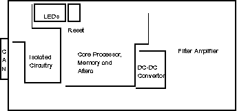
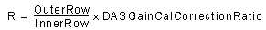
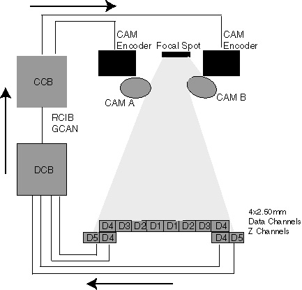
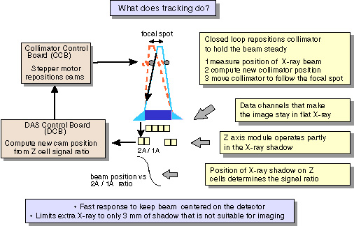
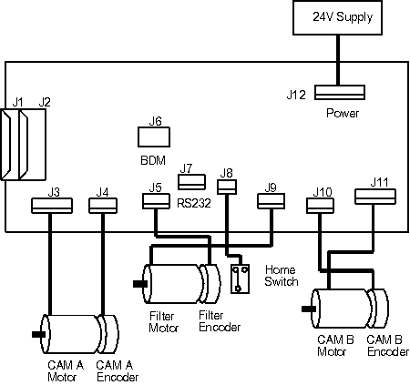
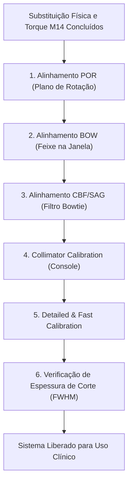

# IT-GE-CT-019: Substituição, Montagem Mecânica e Calibração do Colimador Motorizado - GE BrightSpeed / Brivo CT

|  | **EMED ELETROMEDICINA LTDA.** **Diagnóstico por Imagem** CNPJ: 03.611.974/0001-08 | **CÓDIGO:** `IT-TOMO-GE-019` **VERSÃO:** `2.4 Homologada` **REVISÃO:** `Rev. 02 (26/10/2026)` **NORMA:** `ANVISA RDC 611` |
|:---:|:---|:---|

---

## 1. OBJETIVO E ESCOPO
Esta Instrução de Trabalho (IT) padroniza o procedimento de manutenção de campo para a remoção segura com guincho, substituição da unidade mecânica, conexões eletrônicas da placa CCB, conferência de torques estruturais e execução das rotinas de alinhamento óptico e calibração de software do **Colimador Motorizado (P/N 5140001-6)** nos tomógrafos **GE BrightSpeed (4, 8 e 16 canais)** e **GE Brivo CT385**.

> [!CAUTION]
> **RISCO DE QUEDA DE CARGA PESADA E ESMAGAMENTO**:
> O conjunto do colimador com blindagem de chumbo pesa aproximadamente $25\text{ kg}$. Durante a remoção e reinstalação dos parafusos estruturais M14, utilize obrigatoriamente o suporte mecânico e guincho de serviço (Hoist) devidamente travado. **NUNCA levante o conjunto do colimador segurando pelos motores de passo ou pelas hastes de acionamento do filtro Bowtie**, sob risco de empenamento permanente dos eixos.

---

## 2. ESPECIFICAÇÕES TÉCNICAS E CÓDIGOS DE PEÇAS

| Item / Subsistema | Código Part Number (P/N) | Especificação Técnica / Função |
| :--- | :--- | :--- |
| **Conjunto do Colimador Completo** | P/N 5140001-6 | Chassi blindado com fendas motorizadas de abertura e carrossel de filtros |
| **Placa de Controle do Colimador (CCB)** | P/N 2189441 / 2383563 | Microcontrolador de posicionamento em malha fechada via barramento CAN/RS-422 |
| **Motor de Abertura das Fendas (Cam Motor)** | Conector J2 | Motor de passo de micro-passo para espessuras de corte ($0,625\text{ mm}$ a $20\text{ mm}$) |
| **Motor do Filtro Bowtie (Filter Motor)** | Conector J3 | Posicionamento dos filtros anatômicos (Corpo / Crânio / Pediátrico) |
| **Parafusos Estruturais Principais** | 6 parafusos M14 Allen | Fixação de alta rigidez acoplada à base metálica do tubo de raios-X |
| **Torque de Pré-Fixação (M14)** | $40\text{ N}\cdot\text{m} \pm 3\text{ N}\cdot\text{m}$ | Assentamento inicial sem deformação |
| **Torque Final de Aperto (M14)** | $110\text{ N}\cdot\text{m} \pm 5\text{ N}\cdot\text{m}$ | Aperto definitivo em cruz com trava química de média resistência |

---

## 3. FERRAMENTAL E EQUIPAMENTOS NECESSÁRIOS
1. **Kit Guincho e Braço de Sustentação de Tubo/Colimador (Tube Hoist Assembly)**.
2. **Chaves Hexagonais Soquete (Allen)**: 5 mm, 6 mm, 8 mm, 10 mm e 12 mm.
3. **Torquímetro de Precisão para Cargas Pesadas**: escala de $20\text{ N}\cdot\text{m}$ a $150\text{ N}\cdot\text{m}$.
4. **Dispositivo de Alinhamento Óptico com Alvo Laser (Beam Alignment Fixture - Tool 1)**.
5. **Calibre de Lâminas de Precisão (Feeler Gauge)**: $0,05\text{ mm}$ a $1,00\text{ mm}$.
6. **Manta de Proteção e Pano sem Fiapos**: para limpeza das janelas de Mylar do colimador.
7. **Trava-Rosca Químico Médio (Loctite 242 Azul)**.

---

## 4. ANATOMIA DO COLIMADOR E DIAGRAMAS ESTRUTURAIS

O colimador é composto por um chassi monobloco fundido de alta densidade que acomoda as lâminas de tungstênio móveis e o carrossel do filtro atenuador conformador de feixe (Bowtie Filter):

O posicionamento do filtro é acionado por carne excêntrico e monitorado por sensores ópticos de posição inicial (HOME switches):

A movimentação de precisão micrométrica é executada pelos motores de passo acoplados aos eixos sem-fim:

---

## 5. PROCEDIMENTO DE REMOÇÃO DO COLIMADOR DEFEITUOSO

### 5.1 Desenergização e Travamento
1. Pela console, mova a mesa de exames para o piso mínimo.
2. Gire a gantry e posicione o tubo de raios-X às **3 horas** (ou conforme indicado para o guincho).
3. Engate o **Pino de Travamento de Rotação da Gantry (Rotational Lock)**.
4. Desligue as chaves seccionadoras de serviço da gantry (`Axial Drive Enable`, `HVDC Enable`, `120 VAC`).
5. Aplique Lockout / Tagout no disjuntor da parede.
6. Aguarde 5 minutos para a descarga completa dos capacitores de alta tensão do gerador JEDI.

### 5.2 Desconexão do Chicote Eletrônico
1. Acesse o compartimento da placa CCB na lateral do colimador:

2. Desconecte os 3 conectores principais:
   - **J2**: Cabo do motor de came e microchaves de abertura;
   - **J3**: Cabo do motor do carrossel do filtro Bowtie;
   - **J11**: Cabo de alimentação DC e linha de comunicação serial com o gerador.
3. Desconecte o terminal da trança de aterramento da carcaça do colimador.

### 5.3 Desacoplamento Mecânico com Guincho
1. Instale o suporte do guincho (Tube/Collimator Hoist) na estrutura superior da gantry e trave o pino de ancoragem com a porca castelo de segurança.
2. Fixe as cintas têxteis do guincho nos olhais estruturais dedicados do colimador.
3. Tensione levemente a correia do guincho para absorver o peso de $25\text{ kg}$ da unidade.
4. Com chave Allen de 12 mm, solte gradualmente os **6 parafusos M14**:
   - 2 parafusos superiores;
   - 2 parafusos inferiores;
   - 2 parafusos traseiros.
5. Puxe suavemente o colimador para fora dos pinos-guia cilíndricos e manobre o guincho para depositar a unidade antiga com segurança no chão sobre manta amortecedora.

---

## 6. INSTALAÇÃO DA NOVA UNIDADE DE COLIMAÇÃO

### 6.1 Montagem e Aplicação de Trava Química
1. Inspecione visualmente as janelas de poliéster (Mylar) da nova unidade. Verifique se não há impressões digitais, poeira ou respingos de graxa lubrificante.
2. Com o guincho, eleve o novo colimador e alinhe os dois furos-guia com os pinos de centralização da base metálica do tubo.
3. Aplique duas gotas de adesivo trava-rosca médio (Loctite 242) na rosca de cada um dos 6 parafusos M14.
4. Enrosque manualmente todos os 6 parafusos até encostarem nas arruelas de pressão.

### 6.2 Sequência de Torque Estrutural em Duas Etapas
Utilizando torquímetro calibrado, execute o aperto cruzado em duas fases obrigatórias:

$$\text{Etapa 1 (Pré-Carga / Assentamento)}: \tau_1 = 40\text{ N}\cdot\text{m} \pm 3\text{ N}\cdot\text{m}$$

$$\text{Etapa 2 (Aperto Final Estrutural)}: \tau_2 = 110\text{ N}\cdot\text{m} \pm 5\text{ N}\cdot\text{m}$$

> [!WARNING]
> O torque assimétrico ou insuficiente provocará deflexão do colimador sob forças centrífugas de rotação (até $15\text{ G}$ a $0,8\text{ s/rot}$), desalinhando o plano de radiação com os detectores.

5. Reconecte com firmeza os plugues **J2**, **J3** e **J11** e parafuse a trança de aterramento com torque de $4,5\text{ N}\cdot\text{m}$.
6. Desengate as cintas do guincho e retire o conjunto do guincho da gantry.
7. **Desengate o Pino de Travamento Mecânico da Gantry**.

---

## 7. PROTOCOLO DE ALINHAMENTO ÓPTICO E CALIBRAÇÕES DE CAMPO

Após a instalação física de um novo colimador, é **mandatório** executar a tríade de alinhamentos óptico-geométricos antes de gerar imagens clínicas:

### 7.1 Alinhamento do Plano de Rotação (POR - Plane of Rotation)
1. Instale o dispositivo óptico com alvo laser nos pinos de referência da gantry.
2. Meça o paralelismo da face do colimador em relação ao anel giratório:
   - A deflexão máxima tolerada no indicador relógio comparador é:

$$\Delta_{\text{POR}} \le 0,08\text{ mm (80 micrômetros)}$$

3. Se necessário, efetue o ajuste fino através dos calços espaçadores de precisão (Shims) localizados na base de apoio.

### 7.2 Alinhamento do Feixe na Janela (BOW - Beam on Window)
1. Feche as carenagens do gantry e restabeleça a energia elétrica do sistema.
2. Na console do operador, selecione:
   - `Scanner Utilities` -> `Diagnostics` -> `Collimator Functional Diagnostic Tests`.
3. Verifique o deslocamento dos motores de passo e a detecção dos sensores de fim de curso (`HOME`).
4. Execute o teste radiográfico de centralização BOW:
   - A intensidade do feixe colimado deve ser simétrica entre o primeiro e o último canal do detector com desvio máximo de:

$$\text{Assimetria de Fluxo} \le 1,5\%$$

### 7.3 Calibração Automatizada de Aberturas via Console
1. Garanta que não existam objetos no interior do túnel da gantry.
2. Mova a mesa para a posição inicial de escaneamento (`HOME`).
3. Acesse o menu:
   - `Scanner Utilities` -> `Collimator Calibration`.
4. Clique em `[OK]` na caixa de diálogo de confirmação.
5. Quando o botão `[START]` piscar na botoeira SCIM da console, pressione-o para iniciar as exposições automatizadas. O sistema testará todas as combinações de fenda:
   - Modos 1-canal, 4-canais, 8-canais e 16-canais ($1,25\text{ mm}$, $2,5\text{ mm}$, $5,0\text{ mm}$, $10,0\text{ mm}$ e $20,0\text{ mm}$).
6. Concluída a calibração com sucesso (`Status: PASSED`), execute sucessivamente:
   - `Detailed Calibration`;
   - `Fast Calibration`;
   - `Save System State`.

---

## 8. CONTROLE DE QUALIDADE E LIBERAÇÃO FINAL
- [ ] 6 parafusos estruturais M14 torqueados a $110\text{ N}\cdot\text{m}$ com Loctite 242.
- [ ] Chicotes elétricos J2, J3 e J11 travados e aterramento conectado.
- [ ] Guias e correntes plásticas livres de atrito e sem interferência com as carenagens.
- [ ] Rotina `Collimator Calibration` concluída com aprovação em todos os modos de corte.
- [ ] Teste de Espessura de Corte no Phantom CATPHAN com desvio $\le \pm 10\%$ do valor nominal selecionado.
- [ ] Carenagens recolocadas com todos os parafusos devidamente instalados.
