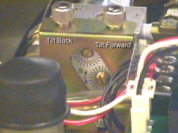

# IT-GE-CT-020: Manutenção, Verificação de Nível, Sangria e Ajuste de Velocidade da Unidade Hidráulica de Tilt - GE BrightSpeed / Brivo CT

|  | **EMED ELETROMEDICINA LTDA.** **Engenharia Clínica & Diagnóstico por Imagem** CNPJ: 03.611.974/0001-08 | **CÓDIGO:** `IT-TOMO-GE-020` **VERSÃO:** `2.4 Homologada` **REVISÃO:** `Rev. 02 (26/10/2026)` **NORMA:** `ANVISA RDC 611` |
|:---:|:---|:---|

---

## 1. OBJETIVO E ESCOPO
Esta Instrução de Trabalho (IT) padroniza o protocolo técnico de manutenção preventiva, verificação de nível com vareta de calibração, reabastecimento de fluido, sangria automática de bolhas de ar e ajuste de precisão das válvulas de velocidade angular do sistema de inclinação hidráulica (**Gantry Hydraulic Tilt System**) dos tomógrafos computadorizados **GE BrightSpeed (Select / Lite / 16)** e **GE Brivo CT385**.

> [!CAUTION]
> **REGRA DE OURO MANDATÓRIA - POSIÇÃO DE VERIFICAÇÃO E ENCHIMENTO**:
> A verificação de nível e o abastecimento de fluido hidráulico devem ser executados **EXCLUSIVAMENTE COM O GANTRY INCLINADO EM SUA INCLINAÇÃO MÁXIMA PARA TRÁS (FULL BACKWARD / -30°)**. Caso o bujão de enchimento seja aberto com a gantry na posição vertical ou inclinada para frente, ocorrerá **transbordamento imediato e derramamento de óleo hidráulico pressurizado** pelos tubos de respiro na carcaça da base.

---

## 2. ESPECIFICAÇÕES TÉCNICAS E CÓDIGOS DE MATERIAIS

| Item / Insumo Técnico | Part Number (P/N) | Especificação / Função Técnica |
| :--- | :--- | :--- |
| **Fluido Hidráulico Oficial GE** | P/N 2227239 | Fluido hidráulico mineral de alta estabilidade térmica e viscosidade controlada (vermelho) |
| **Fita Vedante de Politetrafluoretileno** | Fita Teflon comercial | Vedação das roscas NPT dos bujões de serviço (aplicar exatamente 2 voltas) |
| **Bujão de Enchimento de Serviço** | Parafuso M6 sextavado | Orifício de alívio e inspeção (sem a tubulação plástica de ventilação) |
| **Vareta de Nível Padronizada (Dipstick)** | Chave Allen de 5 mm | Haste metálica limpa com álcool isopropílico para aferição milimétrica |
| **Cilindro Hidráulico de Inclinação** | P/N 721726 | Pistão de dupla ação com retentores hidráulicos reforçados |
| **Motor da Bomba Hidráulica (Tilt Motor ASM)** | P/N 906583 | Conjunto motor elétrico e bomba rotativa de engrenagens |
| **Velocidade Angular Padronizada de Tilt** | $\mathbf{1,0^\circ/\text{s} \pm 0,05^\circ/\text{s}}$ | Taxa constante de basculamento ($25\text{ s}$ para $25^\circ$) |

---

## 3. FERRAMENTAL E EQUIPAMENTOS NECESSÁRIOS
1. **Chave Hexagonal (Allen) de 5 mm** (utilizada também como vareta calibradora de nível).
2. **Chave de Boca / Estrela de 10 mm**.
3. **Bisnaga Plástica Flexível com Mangueira Fina**: para dosagem gota a gota do óleo.
4. **Cronômetro Digital de Precisão com Indicação de Segundos e Décimos**.
5. **Panos sem Fiapos e Papel Absorvente de Alta Densidade**: para contenção preventiva.
6. **Álcool Isopropílico 99,8%**: para desengraxe prévio da haste de medição.
7. **Bandeja de Drenagem**: para posicionamento na base inferior contra respingos.

---

## 4. PROCEDIMENTO DE VERIFICAÇÃO E ENCHIMENTO DE FLUIDO

### 4.1 Preparação Térmica do Sistema (Warm-Up Hidráulico)
1. Remova as carenagens traseiras inferiores da base da gantry.
2. Pelo teclado de comando de gantry, execute movimentações completas de inclinação:
   - Incline para frente até o limite máximo ($+30^\circ$);
   - Incline para trás até o limite máximo ($-30^\circ$);
   - Repita o ciclo de 4 a 6 vezes consecutivas.
3. Toque suavemente na carcaça da bomba hidráulica: o procedimento de medição e abastecimento só deve ser realizado com a **bomba morna ao toque**. A viscosidade nominal do fluido P/N 2227239 depende da temperatura de operação.

### 4.2 Medição do Nível com Vareta Calibradora
1. Com a bomba morna, comande a inclinação da gantry totalmente para trás (**30 graus para trás / S30**).
2. Desligue a chave de serviço `Axial Drive Enable` para evitar movimentos acidentais durante a intervenção manual.
3. Posicione panos absorventes ao redor do cabeçote da bomba.
4. Localize e remova o **parafuso bujão frontal de 6 mm** (o bujão que NÃO possui a tubulação plástica de respiro conectada).
5. Limpe rigorosamente a chave Allen de 5 mm com álcool isopropílico para eliminar qualquer contaminante particulado ou graxa estranha.
6. Insira a haste curta da chave Allen perpendicularmente no orifício de enchimento até encostar na base de apoio e retire-a em seguida:

7. Avalie a marca de umectação de óleo na haste metálica:

$$\text{Nível Correto de Fluido na Vareta} = 15\text{ mm} \pm 2\text{ mm (logo abaixo do bocal de enchimento)}$$

### 4.3 Reabastecimento e Vedação com Fita Teflon
1. Se a película de óleo estiver abaixo de $13\text{ mm}$ na haste, utilize a bisnaga flexível para injetar vagarosamente o óleo oficial GE (P/N 2227239).
2. Adicione pequenos volumes ($10\text{ a }20\text{ ml}$ por vez) e meça novamente com a chave de 5 mm até atingir a marca de $15\text{ mm}$.
3. Limpe perfeitamente a rosca do parafuso bujão de 6 mm com pano seco.
4. Aplique **exatamente 2 voltas completas de fita Teflon nova** na rosca no sentido horário.
5. Reinstale o parafuso bujão e aperte moderadamente com chave sextavada (torque aproximado de $4,5\text{ N}\cdot\text{m}$).

> [!NOTE]
> O circuito hidráulico de tilt não opera como um vaso hermético lacrado. É considerado **perfeitamente normal** observar uma tênue coloração avermelhada ao redor da fita de teflon das junções roscadas (*seeping*). Apenas o acúmulo de poças de óleo (*puddle*) caracteriza vazamento ativo e necessidade de troca de vedações o-ring.

---

## 5. PROCEDIMENTO DE AJUSTE DA VELOCIDADE DE TILT (SPEED ADJUSTMENT)

A velocidade de deslocamento angular deve ser estritamente sincronizada com o encoder e os algoritmos de compensação de corte tomográfico. Uma velocidade incorreta disparará erros intermitentes de `Tilt Overspeed Error` ou `Tilt Stall Error`.

### 5.1 Localização das Válvulas Reguladoras de Vazão
No bloco hidráulico de controle, identifique os dois parafusos de regulagem com porcas de trava:
- **Válvula de Controle de Avanço (Forward Speed Control Valve)**;
- **Válvula de Controle de Recuo (Backward Speed Control Valve)**.

### 5.2 Calibração da Taxa Angular (1 Grau por Segundo)
1. Restabeleça a chave `Axial Drive Enable` para **ON**.
2. Nivele o gantry exatamente no ângulo zero (**0,0°** no display digital frontal).
3. Prepare o cronômetro digital.

#### Calibração do Movimento para Frente (Forward):
4. Pressione e mantenha pressionado o botão de inclinação para frente no gantry.
5. Dispare o cronômetro no momento em que o display começar a mudar de zero.
6. Acompanhe a leitura até o display atingir a posição **S25 (25 graus)**:

$$\text{Tempo Alvo para } 25^\circ = 25,0\text{ s} \quad \left(\text{Taxa} = 1,0^\circ/\text{s}\right)$$

7. Se o tempo for inferior a 24 segundos (muito rápido) ou superior a 26 segundos (muito lento), solte a contraporca de segurança e gire o parafuso da **válvula de avanço**:
   - Sentido Horário -> **Reduz a velocidade** (estrangula a vazão);
   - Sentido Anti-Horário -> **Aumenta a velocidade** (amplia a vazão).

#### Calibração do Movimento para Trás (Backward):
8. Da posição zero (**0,0°**), pressione e mantenha pressionado o botão de inclinação para trás até o display atingir a posição **I25 (25 graus)**.
9. Dispare o cronômetro e observe o tempo decorrido:
   - Ajuste o parafuso da **válvula de recuo** até que o deslocamento de zero a I25 leve exatamente **25,0 segundos**.
10. Reaperte suavemente as contraporcas de travamento sem girar o parafuso calibrado.

---

## 6. SANGRIA AUTOMÁTICA DE AR E TESTE DE ESTABILIDADE (SELF-BLEEDING)
O circuito hidráulico do GE BrightSpeed possui projeto de autopurga (*self-bleeding*) através das câmaras de retorno:
1. Comande o gantry para inclinar totalmente para frente até **S30**.
2. Observe com atenção a velocidade de transição entre **S25** e **S30**:
   - O movimento deve ser contínuo, suave e linear, sem solavancos, ruídos cavitacionais ou reduções bruscas de velocidade.
3. Repita a transição $S25 \rightarrow S30$ e $I25 \rightarrow I30$ por 3 vezes consecutivas.
4. Caso note qualquer engasgo (*stutter*) no final do curso, repita a checagem do nível de óleo no bujão traseiro (Passo 4.2), pois o sistema ainda pode conter microbolhas que comprimem no limite mecânico.
5. Limpe minuciosamente a bandeja da base de qualquer gota residual de fluido.
6. Reinstale as carenagens traseiras da gantry e aperte todos os parafusos de fixação.

---

## 7. CHECKLIST DE LIBERAÇÃO DE CAMPO
- [ ] Verificação e abastecimento realizados estritamente com a gantry a $-30^\circ$ (totalmente para trás).
- [ ] Óleo oficial P/N 2227239 medido a $15\text{ mm}$ na chave Allen de 5 mm.
- [ ] Parafuso bujão vedado com 2 voltas de fita Teflon nova.
- [ ] Velocidade de avanço (Forward) calibrada em $25\text{ s} \pm 0,5\text{ s}$ para $25^\circ$.
- [ ] Velocidade de recuo (Backward) calibrada em $25\text{ s} \pm 0,5\text{ s}$ para $25^\circ$.
- [ ] Contraporcas das válvulas de vazão travadas.
- [ ] Teste de amplitude total $-30^\circ \rightarrow +30^\circ \rightarrow -30^\circ$ sem ruído cavitacional e sem erros de `Tilt Error`.
- [ ] Base da gantry limpa e isenta de poças de óleo.
