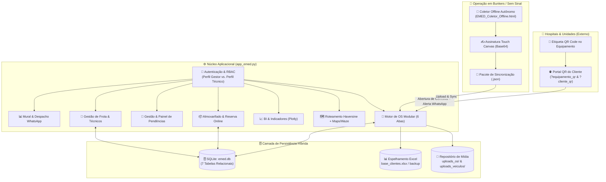
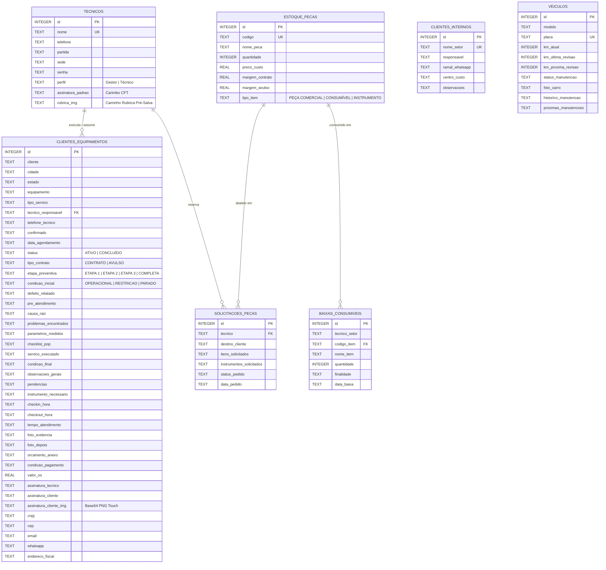
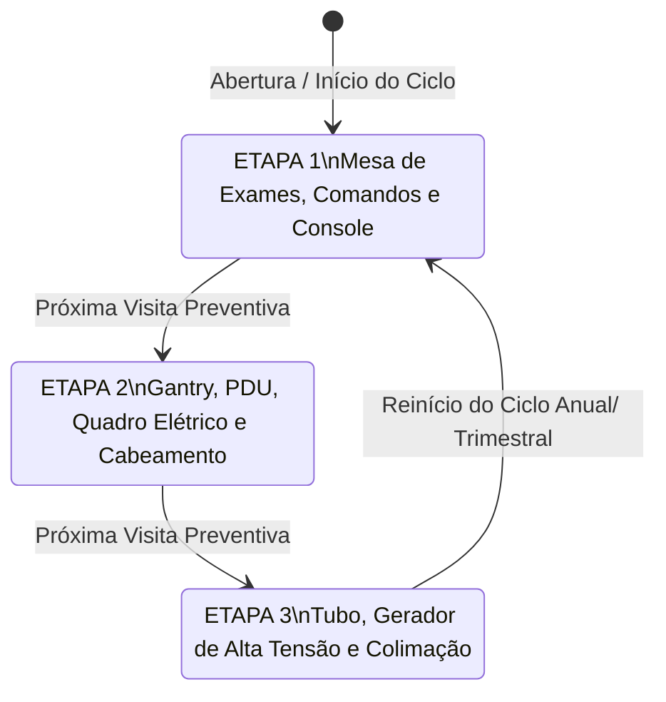

# 🏥 Arquitetura Técnica e Engenharia de Software — Sistema EMED Eletromedicina

**Documento de Arquitetura de Software (SAD — Software Architecture Document)**  
**Versão:** 2.0  
**Escopo:** Gestão de Engenharia Clínica, Ordens de Serviço (Online/Offline), Preventivas Modulares (POP/IT), Almoxarifado em Tempo Real, Faturamento e Frota.

---

## 1. Visão Geral da Arquitetura

O **Sistema EMED** é uma plataforma web e *offline-first* voltada para **Engenharia Clínica e Manutenção de Equipamentos Médicos-Hospitalares** (Tomógrafos, Mamógrafos, Raios-X, Densitometria Óssea, Ressonância, Ultrassom e Patologia).

A arquitetura foi desenhada para operar em dois ambientes complementares:
1. **Ambiente Conectado (Central & Campo Online):** Aplicação reativa baseada em **Python + Streamlit**, persistência relacional local/servidor em **SQLite (`emed.db`)** com espelhamento contínuo de contingência em **Excel (`base_clientes.xlsx` e `base_clientes_backup.xlsx`)**.
2. **Ambiente Isolado (*Offline-First* para Bunkers e Salas Blindadas):** Aplicativo autônomo gerado dinamicamente em **HTML5 + Vanilla JS (`EMED_Coletor_Offline.html`)**, capaz de operar 100% sem internet no celular/tablet do técnico, coletando tempos (Check-in/Check-out), diagnóstico modular, rubrica pré-salva do técnico e assinatura *touch* do cliente (`HTML5 Canvas`), exportando pacotes `.json` para sincronização posterior.

---

## 2. Modelo de Dados Relacional (`emed.db`)

O banco de dados SQLite possui migração incremental automática (`init_db()`), garantindo retrocompatibilidade sem perda de dados por meio de instruções `CREATE TABLE IF NOT EXISTS` e `ALTER TABLE ... ADD COLUMN` protegidas.

### 2.1 Diagrama Entidade-Relacionamento (ERD)

---

## 3. Arquitetura Modular da Ordem de Serviço (6 Módulos)

Para otimizar a ergonomia em dispositivos móveis (celulares utilizados em campo pelos técnicos) e garantir rastreabilidade de nível hospitalar (normas de Engenharia Clínica e POP/IT), a execução da OS é desacoplada em **um cabeçalho de ação rápida** + **6 abas modulares (`st.tabs`)**:

| Módulo | Responsabilidade Técnica | Campos Persistidos |
| :--- | :--- | :--- |
| **Cabeçalho Rápido** | Reatribuição instantânea de técnico e marcação de **Check-in / Check-out** com cálculo automático da duração (`calcular_duracao_os`). | `tecnico_responsavel`, `checkin_hora`, `checkout_hora`, `tempo_atendimento` |
| **1. `📢 Defeito Relatado`** | Triagem inicial, código de erro/sintoma, estado do aparelho na chegada e leitura das últimas 4 intervenções do mesmo equipamento para evitar retrabalho. | `condicao_inicial`, `defeito_relatado`, `pre_atendimento` |
| **2. `🔍 Problemas Encontrados`** | Diagnóstico de Engenharia Clínica, classificação de Causa Raiz e registro de **Parâmetros Elétricos e Ambientais** (Tensão F-N, Terra-Neutro, Temp./Umidade da Sala, Disparos/Horas de Tubo). | `causa_raiz`, `problemas_encontrados`, `parametros_medidos` |
| **3. `🛠️ Serviço & Peças`** | Registro da Etapa da Preventiva (Parte 1: Mesa/Console, Parte 2: Gantry/PDU/Quadro, Parte 3: Tubo/Alta Tensão), Checklist POP/IT e aplicação de peça com baixa automática no estoque. | `etapa_preventiva`, `checklist_pop`, `servico_executado` |
| **4. `🚨 Pendências & Obs.`** | Definição de fechamento (`CONCLUÍDO` vs. `ATIVO`), condição de saída do equipamento (Liberado, Restrição, Parado, Interditado), instrumentos para a próxima visita e recomendações ao hospital. | `status`, `condicao_final`, `instrumento_necessario`, `observacoes_gerais`, `pendencias` |
| **5. `📸 Fotos & Anexos`** | Evidências visuais lado a lado (**Foto Antes/Defeito** e **Foto Depois/Serviço Concluído**) + upload de **Orçamento Aprovado** (PDF/Imagem). | `foto_evidencia`, `foto_depois`, `orcamento_anexo` |
| **6. `✍️ Assinatura & Fecho`** | Cálculo financeiro (**Boleto Integral** vs. **PIX à vista com 10% de desconto**), **Carimbo Automático da Rubrica Pré-Salva do Técnico (CFT)** e **Quadro Touch HTML5 Canvas** para assinatura do cliente com o dedo na tela do celular. | `valor_os`, `condicao_pagamento`, `assinatura_tecnico`, `assinatura_cliente`, `assinatura_cliente_img` |

---

## 4. Fluxos Circulares e Regras de Negócio

### 4.1 Ciclo Circular de Manutenção Preventiva por Partes (POP/IT)
Equipamentos complexos (como Tomógrafos e Mamógrafos) possuem preventivas divididas em etapas para otimizar o tempo de máquina parada no hospital e garantir cobertura profunda:

### 4.2 Ciclo de Vida de Pendências e Reatribuição Dinâmica
1. **Geração da Pendência:** Pode nascer via **Portal QR Code do Cliente**, **Abertura Manual**, **Fechamento Parcial de OS** (`DEIXAR PENDÊNCIA ATIVA`) ou **Sincronização Offline**.
2. **Visibilidade Descentralizada:**
   - O **Técnico** visualiza sua fila em `📋 Minhas Pendências (Técnico)` com o instrumento exato que precisa levar (`instrumento_necessario`).
   - O **Gestor** monitora o painel global em `🚨 Gestão de Pendências` (exclusivo do perfil `Gestor`).
3. **Transferência / Reabertura sem Perda de Histórico:**
   - Caso o técnico titular esteja em viagem ou outro técnico vá à mesma cidade, a OS pode ser **reatribuída** (se aberta) ou **reaberta** (se concluída) para o novo técnico, concatenando o histórico anterior (`|| HISTÓRICO ANTERIOR: ...`) para impedir retrabalho.

### 4.3 Arquitetura de Assinaturas (Técnico Pré-Salvo + Cliente Touch Mobile)
- **Técnico (`renderizar_rubrica_tecnico`):** A rubrica e o registro CFT ficam salvos no perfil do técnico (`tecnicos.assinatura_padrao` e `tecnicos.rubrica_img`). Ao selecionar o técnico executante, o sistema estampa automaticamente o carimbo oficial autenticado.
- **Cliente (`renderizar_quadro_assinatura_cliente`):** Componente `HTML5 Canvas` com suporte a eventos `touchstart`, `touchmove` e `touchend` (`passive: false` para evitar rolagem da tela do celular durante a rubrica). Ao confirmar a assinatura, o componente serializa o traço em `data:image/png;base64,...` e o injeta diretamente no estado do formulário via *native setter* do `HTMLInputElement`.

---

## 5. Padrão de Interface e Blindagem de Tema Escuro (UI/UX)

Para evitar falhas de contraste (caixas brancas com texto branco em diferentes navegadores ou sistemas operacionais), a arquitetura visual aplica **dupla camada de proteção**:
1. **Configuração Nativa do Servidor (`.streamlit/config.toml`):** Define `base = "dark"`, `backgroundColor = "#0b132b"`, `secondaryBackgroundColor = "#1c2541"`, `primaryColor = "#64dfdf"` e `textColor = "#ffffff"`, garantindo que componentes baseados em `<canvas>` (como `st.dataframe` e `st.data_editor`) renderizem nativamente no tema escuro.
2. **Injeção CSS de Alta Especificidade (`app_emed.py`):** Sobrescreve seletores BaseWeb (`div[data-baseweb="select"]`, `div[data-baseweb="popover"]`, `div[data-baseweb="base-input"]`, `div[data-baseweb="textarea"]`, `div[data-baseweb="calendar"]`, `[data-testid="stForm"]`, `[data-testid="stElementToolbar"]` e estados `:disabled`).

---

## 6. Arquitetura Modular Desacoplada, Idempotência e Ciclos Circulares (`emed_core.py`)

O núcleo transacional e de regras de domínio está desacoplado no módulo `emed_core.py` e integrado ao `app_emed.py`:

### 6.1 Persistência Transacional Atômica e Idempotência
1. **Gerenciamento Transacional com WAL (`get_db_connection`) e Preservação de Chave Primária (`salvar_dataframe_transacional`):**
   - Todas as conexões SQLite operam via *Context Manager* (`with get_db_connection(DB_NAME) as conn:`) com `PRAGMA journal_mode=WAL;`, `PRAGMA synchronous=NORMAL;` e `PRAGMA busy_timeout=5000;`, garantindo *commit* e *rollback* atômicos sem *locks* de concorrência.
   - A tabela `clientes_equipamentos` preserva `id INTEGER PRIMARY KEY AUTOINCREMENT` de forma imutável (`garantir_pk_tabela_os` e `obter_id_os`), eliminando o deslocamento de identificadores de OS quando linhas são filtradas ou excluídas.
2. **Sincronização Offline Idempotente (`sincronizar_os_offline_idempotente`):**
   - Cada atendimento offline gera uma assinatura determinística SHA-256 (`sync_hash`). O reenvio do mesmo arquivo `.json` realiza *Upsert* na OS correspondente sem duplicar registros.
3. **Baixa de Peças Idempotente com Validação de Saldo (`aplicar_peca_os_idempotente`):**
   - Valida atomicamente o saldo disponível em `estoque_pecas` antes da baixa na OS e grava a referência na coluna `peca_baixada_ref`, impedindo saldo negativo ou abatimento duplicado em reedições da mesma OS.

### 6.2 Fluxos Operacionais Circulares Fechados
1. **Ciclo Circular de Reserva e Estorno de Estoque (`atualizar_status_solicitacao_peca`):**
   - Permite transitar reservas de `solicitacoes_pecas` para **`ENTREGUE / APLICADO EM CAMPO`** ou **`CANCELADO / ESTORNADO (DEVOLVIDO AO ESTOQUE)`**, recompondo automaticamente o saldo de `estoque_pecas` de maneira idempotente.
2. **Ciclo Comercial-Técnico no Follow-up de Orçamentos (`calcular_dias_aguardando_orcamento`):**
   - Calcula os dias corridos de espera (`>= 15 dias` vs. `< 15 dias`) e disponibiliza aprovação em 1 clique (**`✅ Aprovar Orçamento & Liberar Execução`**), atualizando a OS e liberando o atendimento na escala técnica.
3. **Ciclo Circular de Manutenção Preventiva (`sugerir_proxima_etapa_preventiva` & `agendar_proxima_etapa_circular`):**
   - Inspeciona o histórico do equipamento para sugerir automaticamente a próxima etapa (`ETAPA 1 ➔ ETAPA 2 ➔ ETAPA 3 ➔ ETAPA 1`) na abertura de chamado e permite agendar automaticamente (+30 dias) a próxima etapa ao concluir uma preventiva, sem duplicar agendamentos ativos.

